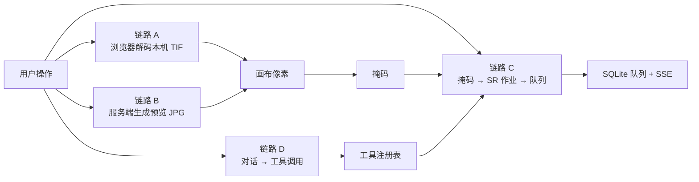
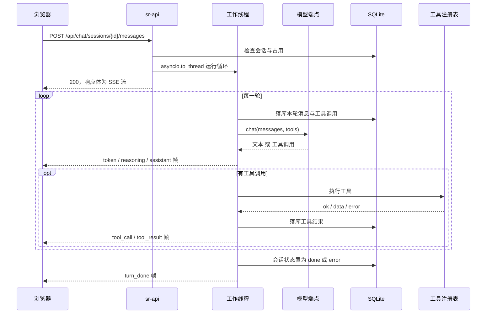

# sr_agent_platform 项目总览与文档索引

> 日期：2026-10-23 · 状态：已定
>
> 本文第一至五节说明项目组成、端到端管线、Agent 调用与部署逻辑；第六至七节是文档索引与归档规则。
> **路径约定**：正文引用一律用项目根目录相对路径；跨文档引用写 `docs/<类目>/<文件>.md`。
> **事实口径**：描述当前仓库代码与当前部署路线。只有单元测试覆盖、尚未在真机验证的环节标注 **待核**。

Skill 加载与外部工具调用接口见 [skill_interface.md](planning/skill_interface.md)。

工具实际暴露条件、描述契约与审计验收见 [tool_description_audit.md](status/tool_description_audit.md)。

Agent 中文交互、执行概览与自动会话标题见 [agent-interaction-titles.md](status/agent-interaction-titles.md)。

PAN/NOSR 局部修复与产物发布见 [pan_repair_contract.md](sr_code/pan_repair_contract.md)。

---

## 一、项目是什么

遥感影像超分（SR）处理平台。浏览器完成影像查看、掩码绘制、作业提交与对话；后端负责场景检索、
生成预览、掩码落盘、作业编排与状态回收；超分算法调用 SR 生产脚本，平台不重写算法。

| 页面 | 作用 | 数据来源 |
|---|---|---|
| `/viewer` 查看器 | 亮度拉伸、像素定位、ROI 统计、掩码绘制、图像对比、《待修复清单》 | 本机 TIF 或盘阵场景预览 JPG |
| `/scenes` 场景库 | 盘阵场景检索（卫星 / 传感器 / 日期 / 关键词）、打开、清除预览缓存 | 服务端生成预览 JPG |
| `/queue` 共享队列 | 提交 SR、SSE 推进状态、取消作业、查看产物目录 | SQLite + 判定文件 |
| `/chat` 对话 | Agent 循环、工具调用、流式正文、推理折叠、截图附件 | LLM 端点 + 工具注册表 |
| `/plugins` 插件管理 | 按机器查看插件目录、期望状态与操作队列 | 实验特性，见 §3.7 |

**技术组成**

- 前端：Vue 3 + TypeScript，Vite 构建，Pinia 管理状态，Vue Router 管理页面。第三方库全部本地内置，
  不依赖 CDN。构建产物由 nginx 静态托管。
- 后端：FastAPI，SQLite 持久化。REST 与 SSE 共用同一个进程。
- 算法：SR 生产脚本与生产解释器，与平台解释器相互独立。
- 模型：任意 OpenAI 兼容的 chat-completions 端点，不绑定供应商。

**边界**

- 平台不实现超分算法，只负责参数、路径、执行与状态。
- 内网环境，接口不做鉴权；副作用由路径白名单与任务指纹兜底。
- 真实遥感数据只在内网机的盘阵上，外网开发机读不到。
- 当前执行路线是本机直跑（`SR_EXECUTOR=local`）；调度器分支保留在仓库中，上线部署不读。
- 机器注册、插件控制面与 trajectory 记录是实验特性，主链路不依赖它们。

---

## 二、端到端管线

### 2.1 四条链路



| 链路 | 起点 | 经过 | 终点 |
|---|---|---|---|
| A 本地影像 | 用户选择或拖入本机 TIF | 浏览器按 UTIF、geotiff 分块、稀疏条带三路分派解码 | 画布像素 |
| B 盘阵场景 | 场景检索、粘路径、拖入文件 | `POST /api/scenes/resolve` → 生成预览 → nginx 静态直出或 `/preview` 回字节 | 画布像素 |
| C 超分作业 | 画布上的掩码 | 掩码落盘 → 参数归一 → 生成 config.xml 与批脚本 → 起子进程 → 读判定文件 | 盘阵产物 + 队列状态 |
| D 对话 | 聊天页或查看器侧舱的一条消息 | Agent 循环 → 工具注册表 → 工具副作用 | SSE 帧 + 落库消息 |

链路 A 与 B 的终点相同，区别在像素来源：A 由浏览器解码源 TIF，B 读取服务端生成的 JPEG。
两条路的掩码坐标都换算到**源影像的元数据尺寸**，因此可以落在同一套坐标里。

### 2.2 盘阵场景从检索到显示

1. `GET /api/scenes` 递归列举 `SR_SCENES_ROOT`。白名单是：所在目录含 `<目录名>_meta.xml`，
   且文件名是 `<目录名>.<ext>` 或 `PAN.<ext>`。这是唯一会列举目录的端点。
2. 其他入口（粘路径、拖入文件）走 `POST /api/scenes/resolve`。该端点只对用户点名的路径做 `stat`，
   不列举目录；反推失败时逐个列出候选与原因，不静默改用其他路径。
3. 缓存判定同时要求两条：预览 JPG 不比源文件旧，且 JPEG 注释里的规则签名等于当前规则。
   规则签名形如 `srprev:v3:div4+equal:q85`，包含缩放档位、拉伸规则与 JPEG 质量。
4. 缩放档位为各边 ÷2、÷4、÷8、÷16、÷32，默认 ÷4。档位写入规则签名，换档后惰性重新生成。
5. 写入位置统一为 `<源 stem>_preview.jpg`。库内场景在缓存就绪时走 nginx 的 `/disk-array/` 静态直出；
   缓存缺失或档位不符时先请求 `/api/scenes/{id}/preview` 生成，再取静态 URL。
   库外场景与拖入链直接由 `/api/scenes/{id}/preview` 或 `/preview-drop` 回字节。
6. 浏览器解码 JPEG 后绘制到 Canvas。掩码与 ROI 使用场景行的 `W`、`H`（源影像尺寸），
   不使用 JPEG 像素尺寸。

浏览器有两项硬上限：单次内存分配约 2GB，Canvas 面积上限 16384²。盘阵上的 GB 级影像因此
不进入浏览器解码，只有用户本机选择的 TIF 才走浏览器本地解码。

### 2.3 掩码到 SR 产物

1. **掩码生成**：浏览器直接生成 `掩码.tif`（值域 0/255）与 `掩膜中心点坐标.txt`；
   也可以把矢量多边形交给 `POST /api/masks`，由后端栅格化并写入场景目录。
   0 表示不处理，255 表示处理；SR 侧按大于 0 读取。坐标以源影像为准，x 为列、y 为行。
2. **提交**：`POST /api/queue`。后端完成路径归一、白名单校验、掩码推导与锁定目录检查。
   请求不带 `mask_path` 时，按 `<lq_path>/<输入影像 stem>_mask.tif` 推导；文件不存在直接返回 400，
   不退化成整图超分。
3. **幂等**：提交参数规范化后取 sha256，作为 `sr_tasks.task_fingerprint`，是表的唯一键。
   同参数重复提交复用同一行，不会投出第二个作业。对话工具与队列页共用同一套参数归一。
4. **生成作业文件**：在 `SR_SLURM_WORK_DIR` 写两份文件——`run_sr_<后缀>_<指纹前 12 位>.xml`
   （config.xml）与同名批脚本。批脚本包含资源指令、审计段、SR 入口脚本与契约校验器。
   `SR_SR_SCRIPT` 与 `SR_VERIFY_SCRIPT` 在生成时写死进脚本，修改后必须重启服务。
5. **执行**：`SR_EXECUTOR=local` 时由 `local_exec.py` 在本机起 `bash` 子进程，单槽串行，
   后到的作业排队。子进程使用 `SR_PYTHON` 指向的 SR 生产解释器，删除 `VIRTUAL_ENV`、
   `PYTHONHOME`、`PYTHONPATH`，保留 `LD_LIBRARY_PATH`，并设置 `CUDA_VISIBLE_DEVICES`。
6. **作业内**：SR 脚本读取 config.xml 与场景目录，写出 `<输入名>_<Suffix>.tif` 与 `Debug/` 日志。
7. **契约校验**：`verify_sr_run.py` 紧跟 SR 脚本运行，逐条检查：进程退出码为 0、
   SRLOG 末行为 `Run finished.`、输出 tif 存在且非空。三条满足写 `verdict=0`，否则写 `verdict=90`。
   云量跳过以 `Run skipped:` 开头，只要求前两条。
8. **终态回收**：作业内校验器把结论写入**判定文件** `<DatarootLQ>/Debug/_SREXIT_<job_id>.txt`。
   后端只读这个文件：
   `verdict=0` → COMPLETED（含合法跳过），`verdict!=0` → FAILED，读不到 → UNKNOWN。
   **进程退出码 0 不等于成功**；调度器账务（`sacct`）在真机永久不可用，也不使用。
9. **状态广播**：后台按 `SR_QUEUE_POLL_SEC`（默认 2 秒）校准未终结作业，写回 SQLite 并广播
   `job_update` 帧。队列状态只有 PENDING、RUNNING、COMPLETED、FAILED、UNKNOWN 五种。
   耗时口径为纯算力时长，不含排队。
10. **产物预览**：作业转 COMPLETED 后，后台循环按 `SR_PRODUCT_PREVIEW_DIV`（默认 ÷4，0 表示关闭）
    为产物生成预览，受 `SR_PRODUCT_PREVIEW_MAX_AGE_SEC` 年龄窗口约束。该变量与前端的缩放档位
    是两个独立配置，默认值相同但互不联动。

### 2.4 产物与未超分影像的命名

- 产物：`<输入 stem>_<Suffix>.tif`。
- 未超分影像：输入影像的 stem 加 `_NOSR`。SC 场景为 `<目录名>_NOSR.tif`，RC 场景为 `PAN_NOSR.tif`。
  `<产物 stem>_NOSR.tif` 是次选候选，仍在候选清单中。
- 场景行按“环节”区分本体、本轮产物与 NOSR。前端 `lib/stage.ts` 负责这一映射。

### 2.5 跨层约束

| 约束 | 原因 |
|---|---|
| 掩码坐标使用源影像元数据尺寸 | 预览是降采样的，用 JPEG 尺寸会让掩码整体错位 |
| 预览档位读取盘上 JPEG 的注释 | 换机器或他人先生成过时，前端记忆不可信 |
| 解码结果写入前比对代号 | 本地解码可能耗时较长，过期结果不能覆盖新图 |
| 服务层不返回 HTTP 概念 | 异常到状态码的翻译集中在路由层，便于单测 |
| 后端不 import SR 侧模块 | 两侧解释器与依赖完全不同，只通过批脚本文本交接 |
| 服务端只对点名的路径做 `stat` | 避免请求路径隐式列举盘阵目录 |

---

## 三、Agent 调用

### 3.1 形态

Agent 是自写的状态机，位于 `backend/agent/loop.py`。不引入 langchain 或 langgraph，
依赖只有模型客户端与工具注册表。这样做的目的是让每一步都可落库、可推帧、可在崩溃后恢复。

模型侧使用 OpenAI 兼容的 chat-completions 接口。端点、模型、密钥、超时、流式开关全部由环境变量配置，
因此更换模型不需要改前后端代码。

### 3.2 一次回合



- 同一会话同一时刻只允许一个回合；已有请求在跑时再发返回 409。不同会话之间不互相阻塞。
- 工具报错不中断循环。错误作为工具结果回灌给模型，由模型决定下一步。
- 轮次上限默认 8。达到上限以 `max_turns=N reached` 结束，会话状态为 `error`，不是 `done`。
- 每条消息在产生副作用的步骤之前落库。恢复会话时，对“有工具调用但没有结果”的轮次补一条
  “结果未知，不要盲目重试”的合成结果，不盲目重跑有副作用的工具。

### 3.3 工具注册表

工具用装饰器注册进进程内的 `ToolRegistry`，每个工具提供名字、给模型看的一句话说明、参数 JSON Schema，
执行后统一返回 `{ok, data, error}`。

| 工具 | 作用 | 副作用 |
|---|---|---|
| `search_scenes` | 检索盘阵场景，返回 id、路径、卫星、传感器、日期；默认范围是当前 Viewer 工作区（`scope=library` 才扫全库），两种范围都排除已隐藏场景 | 只读 |
| `run_sr` | 归一参数并提交 SR 作业，返回 `job_id` | 写作业文件、写 `sr_tasks`、起子进程 |
| `sr_job_status` | 查询作业状态与退出码 | 只读 |
| `fix_bad_lines` | 检测并修复坏线；给定 `output_path` 时写文件 | 可选写文件 |

同一份注册表服务两条入口：Agent 循环用 `manifest()` 生成模型的工具定义；
`POST /api/tools/{name}` 直接调用 `tool.run`。两条入口的 `run_sr` 参数归一产出同一个任务指纹，
因此从对话提交与从队列页提交的同参数作业在库里是同一行。

**已知限制**：`sr_job_status` 当前直接调用调度器客户端，没有走 `run_sr.query_job_status` 的执行器分派，
也没有传判定文件路径。在本机直跑路线下，该工具会报错或返回 UNKNOWN。
队列页的状态回收走的是 `query_job_status`，不受影响。

### 3.4 模型接入

| 环境变量 | 默认值 | 说明 |
|---|---|---|
| `SR_LLM_BASE_URL` | `https://api.openai.com/v1` | 任意 OpenAI 兼容端点 |
| `SR_LLM_API_KEY` | 空 | 本地端点可留空 |
| `SR_LLM_MODEL` | `gpt-4o-mini` | 模型标识 |
| `SR_LLM_MAX_TOKENS` | `1024` | 单轮补全上限 |
| `SR_LLM_TEMPERATURE` | `0.2` | 采样温度 |
| `SR_LLM_TIMEOUT` | `60` | HTTP 超时秒数 |
| `SR_LLM_STREAM` | `1` | 流式输出总开关；`0` 退回一次性调用 |
| `SR_LLM_MOCK` | 关 | `1` 时使用固定脚本，不连任何端点 |

`SR_LLM_MOCK=1` 是链路开关，不是降级模式。它运行完整循环，只替换模型那一端：
第一轮固定调用 `search_scenes`，拿到结果后返回一段总结。没有模型端点时，用它验证会话串行、
SSE 帧序、工具结果回灌与历史恢复。

端点若用于带截图的回合，必须支持视觉输入：请求会把截图作为
`{"type":"image_url","image_url":{"url":"data:image/jpeg;base64,..."}}` 内容块发出。
服务端不做静默降级，带图回合在缺少视觉能力时会整轮报错。

### 3.5 SSE 帧

聊天回合的帧类型：`turn_start`、`llm_phase`、`reasoning`、`token`、`assistant`、`tool_call`、
`tool_result`、`usage`、`error`、`turn_done`。

- `token` 是正文增量，`reasoning` 是推理增量，二者分别上屏。推理内容不落库。
- `tool_call` 与 `tool_result` 驱动工具卡片；同一套归并函数也用于读取历史，刷新前后形状一致。
- 队列事件流的帧类型为 `job_update` 与 `preview_update`。

### 3.6 前端表现

- 正文逐 token 上屏。Qwen 等模型的推理内容进入可折叠的“思考过程”块。
- 服务端 `SR_LLM_STREAM=0` 是总开关；设置浮层可按浏览器关闭，下一回合生效。
- 截图附件来自查看器当前可见画面，每条消息最多 2 张，作为真正的图像内容块发给多模态模型。
- 查看器侧舱与 `/chat` 共用同一会话与同一套消息归并逻辑。

### 3.7 实验特性

以下功能代码已存在，但不在当前生产主链路上，真机未验收。

**机器与插件控制面**

- `backend/services/plugins.py` 维护插件目录、机器目标状态与操作队列；
  `backend/services/store.py` 持久化机器、插件状态与操作记录。
- 机器通过 `X-Machine-ID` 选择插件集合，缺省为 `local`。本机内置插件的操作立即完成；
  远程机器的操作进入 PENDING 队列，由机器侧 Agent 拉取并回报结果。
- 内置目录包含四个执行型工具插件，以及一个观测型 UI 插件 `token_visualizer`。
  观测型插件不进入 function-calling 列表，只消费模型响应里的 usage 数据。
- `desired_state` 表示后台期望状态，`actual_state` 表示机器回报状态。

**trajectory 记录**

- `agent_runs` 记录一次 `run_loop` 的模型、机器、提示摘要、工具清单哈希、最终状态与答案。
- `trajectory_events` 按 `seq` 追加运行事件，覆盖运行开始、轮次、模型请求、助手输出、
  工具执行、错误与运行结束。
- payload 写入前按敏感键脱敏，并限制为 32 KiB；超出部分保留预览、字节数与 SHA-256。
- 聊天页可对一次运行提交“有帮助 / 需改进”反馈；同一个运行只接受一次反馈，重复提交返回 409。
- 现有聊天 SSE 与 messages 恢复协议不因 trajectory 改变。

---

## 四、部署逻辑

### 4.1 拓扑

真机是一台 CentOS7 内网机。五个角色同机运行：

| 角色 | 形式 | 身份 | 职责 |
|---|---|---|---|
| nginx | 常驻进程 | `User=nginx` | 托管 dist、静态直出盘阵 JPG、反向代理 `/api/` |
| sr-api | systemd + uvicorn，监听 `127.0.0.1:8000` | `User=nginx` | REST / SSE、SQLite、生成作业文件、起作业进程 |
| SR 作业 | 由 sr-api 派生的短生命周期子进程 | 继承 `nginx` | 运行 SR 脚本与契约校验器，写产物与判定文件 |
| SQLite | sr-api 进程内打开的文件 | — | 会话、消息、用量、作业、机器与插件状态 |
| 盘阵 | 宿主文件系统 | — | 源影像、预览 JPG、掩码、产物、日志 |

**两个解释器平行存在、互不污染**：

| | 平台侧 | SR 作业侧 |
|---|---|---|
| 路径 | `/opt/sr-venv`，Python 3.9 | `SR_PYTHON`，conda Python 3.6 |
| 依赖 | fastapi、uvicorn、pydantic、Pillow、numpy | torch、GDAL、`ImgHistMatch.so` |
| 启动方 | systemd | sr-api 起子进程 |

后端不 import SR 的任何模块，只把解释器路径写进批脚本。SR 生产环境锁在 Python 3.6，装不了 FastAPI；
平台侧也不需要 torch。

### 4.2 nginx 的路径分工

| 前缀 | 行为 | 关键点 |
|---|---|---|
| `/assets/` | 带哈希的构建产物 | 长缓存、immutable |
| `/disk-array/` | `alias` 到盘阵根 | 不经过后端，这是路径白名单之外的第一层保护 |
| `/api/` | 反代 `127.0.0.1:8000` | SSE 关闭缓冲；`/preview` 子块必须重写 `proxy_pass` |
| `/` | SPA history fallback | `try_files $uri $uri/ /index.html` |

`/disk-array/` 的 `alias` 只暴露 `SR_SCENES_ROOT`，不要放大到整个盘阵根。放大后静态直出不过后端，
路径白名单会退化成唯一一层。

nginx 在 `/api/` 下再套 location 时，子块必须重新写一遍 `proxy_pass`。nginx 只选择一个 location，
嵌套块不继承 `proxy_pass`；漏写会让请求落回静态查找，由 nginx 返回 404 HTML。

### 4.3 路径白名单

`backend/pathguard.py` 是命名规则与路径校验的唯一真源。前端不自行拼接候选路径，只发文件名或整条路径。

1. `to_posix_array_path` 按 `SR_DRIVE_MAP` 把 Windows 盘符形态归一成 POSIX 形态，默认 `W:=/DiskArray`。
2. `ensure_allowed` 校验前缀是否在 `SR_ALLOWED_ROOTS` 之下，默认 `/DiskArray`。
3. 请求路径只对用户点名的路径做 `stat`，不列举目录。

`GET /api/scenes` 本身是检索端点，会递归列举 `SR_SCENES_ROOT`。其他请求路径由测试固定为禁止列举。

### 4.4 权限

sr-api 以 `nginx` 身份运行，它派生的 SR 作业也继承这个身份。上机验证一律用 `sudo -u nginx` 复现，
不要用 root 试。

| 动作 | 需要 | 不可写时的行为 |
|---|---|---|
| 掩码写入场景目录 | 目录可写 | 返回 400/422，前端提示 |
| 预览 JPG 写入场景目录 | 目录可写 | 先预判，不可写则回退到 `SR_TEMP_PREVIEWS_ROOT`，响应头带 `X-SR-Preview-Fallback: tmp` |
| 场景库清除预览缓存 | 对目标文件可 `unlink` | 逐条报失败，不删任何文件 |
| 《待修复清单》写回 | 目标文件可写 | 返回 422 |
| SR 作业写产物 | `lq_path` 可写 | 作业无法写判定文件，终态停在 UNKNOWN |

真机页面是 `http://内网IP`，不是 SecureContext。`showOpenFilePicker`、剪贴板等浏览器 API 不可用；
需要写盘阵的功能一律走后端。

### 4.5 交付与升级

开发机（Windows、外网）构建并打包，内网机解压运行。产物固定在仓库根 `release/`：

```text
release/
├── dist-<日期>-<时分>-<版本>.tar.gz       # 顶层 dist/
└── backend-<日期>-<时分>-<版本>.tar.gz    # 顶层 backend/
```

两个包顶层都不带项目目录前缀，真机直接 `tar -xzf <包> -C <APP>` 覆盖 `dist/` 与 `backend/`。
前端与后端之间没有版本协商，**两个包必须同版本更新**。

首次安装件不进包：`nginx.conf`、`sr-api.service`、`requirements-api.txt`、部署说明。它们是机器配置模板，
真机上已按实际路径修改；打包解压会把路径盖回示例值。首次部署从 `deploy/` 直接拷贝。

| 改动层 | 开发机动作 | 服务器动作 |
|---|---|---|
| 前端 `frontend/src/` | 重新构建，重打 dist 包 | 覆盖 `dist/` → `chown -R nginx:nginx` → `systemctl reload nginx` |
| 后端 `backend/` | 重打 backend 包 | 覆盖 `backend/` → `chown -R nginx:nginx` → `systemctl restart sr-api` |
| systemd 单元或 drop-in | 修改配置文件 | `systemctl daemon-reload` → `restart sr-api` |
| nginx 站点配置 | 修改配置文件 | `nginx -t` → `reload nginx` |
| 环境变量 | drop-in | 同 systemd；`SR_SR_SCRIPT`、`SR_VERIFY_SCRIPT` 写死在批脚本里，必须重启 |

覆盖后必须重新 `chown`：scp 或网盘拷入的文件属主是 root，而服务以 `nginx` 运行。

回滚是用上一版的两个包覆盖解压，再 reload / restart。解压是覆盖而不是替换，旧的
`assets/<旧哈希>.js` 会残留，不影响运行。

### 4.6 配置入口

环境变量是唯一配置入口。`config.py` 的 `sr_runtime()` 每次调用都重读环境变量，不缓存；
`load_config()` 在应用创建时读取一次。

已部署机器上修改环境变量使用 systemd drop-in，不改主单元文件：

- 路径为 `/etc/systemd/system/sr-api.service.d/NN-<名字>.conf`，`NN` 决定加载顺序。
- 第一行必须是 `[Service]`。缺少段头时 systemd 不报错也不警告，整个文件被静默忽略。
- 判断变量是否生效看 `systemctl show -p Environment sr-api`，不要只看 `systemctl cat`。

**当前路线与仓库默认值的差异**：仓库默认 `SR_EXECUTOR=slurm`，真机部署必须显式覆盖为 `local`。
漏掉这一项，提交会走已冻结的调度分支，而不是本机直跑。

### 4.7 验证

每次改动后先做本地冒烟，再开浏览器：

```bash
curl -s -o /dev/null -w '静态=%{http_code}\n' http://127.0.0.1/            # 应 200
curl -s -o /dev/null -w '健康=%{http_code}\n' http://127.0.0.1/api/health  # 应 200
```

改动过 nginx 时，再检查反向代理是否真的到达后端：

```bash
curl -s -o /dev/null -w '反代=%{http_code} ct=%{content_type}\n' \
     'http://127.0.0.1/api/scenes/__none__/preview?div=4'
# 正确：反代=404 ct=application/json
# 错误：反代=404 ct=text/html（nginx 自己返回的，说明子 location 缺少 proxy_pass）
```

完整部署步骤、环境变量全表与真机路径见 [deploy/README.md](../deploy/README.md)；
真机部署现状与症状表见 [real-machine-bringup.md](status/real-machine-bringup.md)；
真机配置与仓库默认值的偏差见 [current-question.md](status/current-question.md)。
配置文件位置及已确认的 systemd 覆盖顺序见 [config_locations.md](status/config_locations.md)。

---

## 五、项目目录结构

```text
sr_agent_platform/
├─ backend/                     FastAPI 后端
│  ├─ agent/loop.py             Agent 状态机
│  ├─ api/
│  │  ├─ app.py                 应用工厂、场景与预览路由
│  │  ├─ platform.py            工具、对话、队列、掩码、清单、机器与插件路由
│  │  └─ paths.py               场景 id 编解码、场景根读取
│  ├─ config.py                 环境变量与默认值
│  ├─ pathguard.py              路径归一、白名单、场景名反推
│  ├─ contracts/                查看器上下文契约
│  ├─ mta_grid/                 网格对齐算法
│  ├─ plugins/                  内置插件清单与加载
│  ├─ services/                 业务服务：检索、预览、掩码、作业编排、执行器、存储
│  ├─ tools/                    工具注册表与四个内置工具
│  └─ tests/                    后端 pytest
├─ frontend/                    Vue 3 前端
│  ├─ src/pages/                查看器、场景库、队列、对话、插件管理
│  ├─ src/components/           页面组件
│  ├─ src/composables/          组合式逻辑
│  ├─ src/lib/                  纯函数层：API 客户端、解码、掩码、坐标、缓存
│  ├─ src/stores/               Pinia 状态与编排
│  ├─ src/vendor/               本地内置的 UTIF、geotiff、pako
│  ├─ src/extensions/           前端扩展注册表
│  ├─ src/viewer/               查看器端到端测试钩子
│  ├─ scripts/                  构建、打包、术语检查、测试图生成
│  ├─ fixtures/                 入库的小型测试影像
│  └─ dist/                     构建产物（不入库）
├─ deploy/                      部署模板与部署说明
│  ├─ README.md                 打包、安装、升级、回滚、本机执行 SR
│  ├─ nginx.conf                站点模板
│  ├─ sr-api.service            systemd 单元模板
│  ├─ requirements-api.txt      后端依赖
│  └─ slurm/                    调度器路线探针（存量，部署不读）
├─ SR_code/                     SR 生产算法侧文件
│  ├─ code_0817_prod.py         SR 生产入口脚本
│  ├─ util.py                   生产工具函数
│  ├─ variants/                 平台部署变体与契约校验器
│  └─ tools/                    变体生成器
├─ .e2e/                        浏览器回归脚本（脚本入库，依赖与测试图不入库）
├─ release/                     离线交付包输出（不入库）
├─ tif_viewer/tif-viewer.html   独立单文件查看器，不参与平台构建
├─ quick-look.html              独立单文件查看器，不参与平台构建
├─ docs/                        项目文档，分类见第六、七节
├─ AGENTS.md                    协作约定
└─ CLAUDE.md                    项目导航
```

不参与构建与部署的目录：`langchain-master/`、`langgraph-main/`、`deepseek-harness-master/` 是参考源码，
只读、不入库；`docs/agent-book/` 是第三方书籍转录，不入库；`CloudReview_Update_*/` 是独立的云量复核工具，
与本平台没有调用关系；`test-tifs/` 是本地测试影像，不入库。

### 5.1 后端依赖方向

依赖方向是单向的，四条约束用来避免循环依赖：

1. `config.py` 不 import 任何服务模块，它是默认值的单一真源。
2. `pathguard.py` 不依赖后端内部模块，被路由层与缓存层共用。
3. `preview_cache.py` 只依赖 `pathguard.py`，不 import `api/paths.py`。
4. `services/*` 不出现 FastAPI 类型，异常到状态码的翻译集中在路由层。

### 5.2 前端分层

组件只负责显示与事件；store 负责状态与编排；`lib/` 是无副作用的纯函数层。
唯一持有画布的组件是 `TifCanvas.vue`，重绘由 store 里的自增信号驱动。
场景列表接口由 `stores/scenes.ts` 直接发起请求，因为 query 串拼装在 `lib/scene.ts`；
其余请求统一经过 `lib/api.ts`。

---

## 六、文档索引

### 6.1 交接与状态（`docs/status/`）

| 文档 | 内容 |
|---|---|
| [current-question.md](status/current-question.md) | 平台现状、当前路线、未收口项、下一步、现值速查。新会话先读 |
| [durable_goal_runtime.md](status/durable_goal_runtime.md) | Goal/Round 执行、SR 自动续跑、Lease Fencing、独立验收与自动化验证 |
| [goal_clarification.md](status/goal_clarification.md) | Goal 澄清、WAITING_USER、原子回答/恢复、崩溃窗口与实测验收 |
| [runtime_status.md](status/runtime_status.md) | 每次模型请求的临时运行状态、计数口径、注入边界与测试 |
| [sr-local-execution.md](status/sr-local-execution.md) | 本机执行 SR 的链路与运行期规则：单槽串行、重启、UNKNOWN、判定文件 |
| [real-machine-acceptance.md](status/real-machine-acceptance.md) | 真机验收判据与勾选 |
| [real-machine-bringup.md](status/real-machine-bringup.md) | node81-135 的部署与启动运行手册 |
| [real-machine-bringup-adhd.md](status/real-machine-bringup-adhd.md) | 上文的逐步操作版 |
| [timeline-archive.md](status/timeline-archive.md) | 历史时间线，仅在追溯决定或事故时按日期检索。不是现状 |
| [handoff-prompt.md](status/handoff-prompt.md) | 新窗口梳理框架用的开工提示词 |
| [bugfix-prompt.md](status/bugfix-prompt.md) | 新窗口修缺陷用的开工提示词 |

### 6.2 背景知识（`docs/knowledge/`）

| 文档 | 内容 |
|---|---|
| [platform-tutorial.md](knowledge/platform-tutorial.md) | 从 0 开发本平台的前后端教程，读代码前的首选 |
| [preview-bake-pipeline.md](knowledge/preview-bake-pipeline.md) | 盘阵场景从路径到预览 JPG 的完整链路：生成、缓存判定、显示 |
| [io-pipeline/README.md](knowledge/io-pipeline/README.md) | 架构视图：分层、四条链路、部署拓扑、模块交互与跨层纪律 |
| [io-pipeline/browser-io.md](knowledge/io-pipeline/browser-io.md) | 链路 A：本地影像到画布 |
| [io-pipeline/scene-io.md](knowledge/io-pipeline/scene-io.md) | 链路 B：盘阵场景预览到画布 |
| [io-pipeline/sr-io.md](knowledge/io-pipeline/sr-io.md) | 链路 C：掩码到 SR 作业与队列 |
| [io-pipeline/agent-io.md](knowledge/io-pipeline/agent-io.md) | 链路 D：对话到工具调用 |
| [io-pipeline/topology.md](knowledge/io-pipeline/topology.md) | 部署拓扑、进程边界、环境变量与权限 |
| [io-pipeline/module-map.md](knowledge/io-pipeline/module-map.md) | 后端依赖方向、端点与 IO 对照表 |
| [agent-orchestration-research.md](knowledge/agent-orchestration-research.md) | langchain、langgraph、deepseek-harness 对比与自写循环的决策依据 |
| [tool_result_budget.md](knowledge/tool_result_budget.md) | 工具完整结果、模型视图、预算配置、会话隔离引用及恢复 |
| [llm-serving-gguf-glossary.md](knowledge/llm-serving-gguf-glossary.md) | llama.cpp 与 GGUF 生态名词、本地部署选型 |
| [jpg-export-background.md](knowledge/jpg-export-background.md) | 独立查看器导出 JPG 的背景知识与内存账本 |
| [interview/README.md](knowledge/interview/README.md) | 面试复习索引；含 JS/TS、Vue、Canvas、SSE、FastAPI、并发、存储、项目深挖八篇 |

### 6.3 需求与规划（`docs/planning/`）

| 文档 | 内容 |
|---|---|
| [api-contract.md](planning/api-contract.md) | 平台 REST / SSE 契约：端点、参数、错误码、帧类型。截图、trajectory、机器与插件端点以代码和对应 planning 文档为准 |
| [gui-requirements.md](planning/gui-requirements.md) | Agent 与 GUI 平台的中长期需求与阶段目标 |
| [frontend-migration.md](planning/frontend-migration.md) | tif-viewer 迁移到 Vue 3 的范围、阶段与验收 |
| [frontend-phase4-phase5-prompts.md](planning/frontend-phase4-phase5-prompts.md) | 已归档的开工提示词，供追溯，不照抄重做 |
| [sr-minimal-prototype-plan.md](planning/sr-minimal-prototype-plan.md) | 前端提交到本机直跑的最小原型实现说明 |
| [sr-pipeline-restore-plan.md](planning/sr-pipeline-restore-plan.md) | SR 提交链路的分阶段恢复清单；调度器阶段冻结 |
| [agent-llm-deployment.md](planning/agent-llm-deployment.md) | 本地大模型部署的选型维度、验收法与开放问题 |
| [agent-trajectory.md](planning/agent-trajectory.md) | trajectory 记录与反馈采集的实现说明 |
| [plugin-management.md](planning/plugin-management.md) | 插件控制面：目录、机器状态、操作队列 |
| [code_cohesion_decoupling_execution_plan.md](planning/code_cohesion_decoupling_execution_plan.md) | 提高内聚、降低耦合的工作包与实施状态 |
| [qwen3.8plan.md](planning/qwen3.8plan.md) | Qwen3.8-27B 量化模型汇总与部署选型 |
| [qwen3.8download.md](planning/qwen3.8download.md) | Qwen3.8-27B GGUF 文件清单与下载选择 |
| [qwen3.8unsloth-fork-download.md](planning/qwen3.8unsloth-fork-download.md) | Unsloth 下载页的社区量化模型清单 |
| `web-plan.md` | 内部实施计划，`.gitignore` 排除，不入库 |

### 6.4 经验与复盘（`docs/experience/`）

| 文档 | 内容 |
|---|---|
| [gui-experience.md](experience/gui-experience.md) | 大 TIF 查看器的硬约束、已验证方案与踩坑结论 |

### 6.5 规范与约定（`docs/conventions/`）

| 文档 | 内容 |
|---|---|
| [naming-conventions.md](conventions/naming-conventions.md) | 文件名、目录名、标识符的命名规则与分类 |
| [terminology-conventions.md](conventions/terminology-conventions.md) | 正文与注释的用词：主词、禁用词、黑话替换 |
| [current-state-conventions.md](conventions/current-state-conventions.md) | 叙述口径：只写当前状态，不写修改经过 |
| [motion-conventions.md](conventions/motion-conventions.md) | 前端动效的时长令牌与缓动令牌选用规则 |
| [langchain-boundary.md](conventions/langchain-boundary.md) | 参考源码的使用边界：不 import、不安装、不进入平台代码 |

### 6.6 SR_CODE 生产管线（`docs/sr_code/`）

| 文档 | 内容 |
|---|---|
| [sr-pipeline-overview.md](sr_code/sr-pipeline-overview.md) | 局部超分算法的实现全览 |
| [sr-pipeline-interface.md](sr_code/sr-pipeline-interface.md) | 平台与 SR 管线之间的唯一调用契约 |
| [sr-windows-porting-pitfalls.md](sr_code/sr-windows-porting-pitfalls.md) | Windows 移植的环境基线、依赖与踩坑 |
| [sr-platform-variant.md](sr_code/sr-platform-variant.md) | 平台部署变体与生产脚本的逐条差异 |
| [production-scene-naming.md](sr_code/production-scene-naming.md) | 生产场景命名规则、六层目录与由文件名反推路径 |

---

## 七、文档分类与新增规则

### 7.1 判断类别

写新文档前按以下顺序判断，放入对应目录：

1. **交接与状态**：记录当前做到哪、下一步交给谁 → `docs/status/`
2. **规范**：约束文件命名、用词、叙述口径、动效或流程 → `docs/conventions/`
3. **需求与规划**：回答要做什么、按什么范围做 → `docs/planning/`
4. **经验**：记录踩过的坑与已验证方案 → `docs/experience/`
5. **其余**：原理、背景、技术实现说明 → `docs/knowledge/`

类别不确定时放入 `docs/knowledge/`，并在头部标注“草稿”。新增类目先在
[naming-conventions.md](conventions/naming-conventions.md) §6 登记。

`docs/sr_code/` 是按主题域归档的例外类目，集中放置 SR 生产管线相关文档，便于整体调阅。

### 7.2 命名与头部

- 文件名用英文 snake_case，主体体现主题，避免中文名与裸日期。
- 每份文档首部固定一行元信息：标题、日期、状态（草稿 / 评审 / 已定）。
- 正文引用使用项目根目录相对路径。
- 参考代码目录内不放 `.md` 文件。

### 7.3 写作约束

写任何文档前先读三份规范：

- [terminology-conventions.md](conventions/terminology-conventions.md)：同一个概念用同一个词。
  界面与正文写“生成预览 / 预览 JPG / 预览生成规则 / 缩放档位”。
- [current-state-conventions.md](conventions/current-state-conventions.md)：只写现状，不写修改经过。
- [motion-conventions.md](conventions/motion-conventions.md)：前端动效只使用 `--motion-*` 与 `--ease-*` 令牌。

第三方转录与外部导入的存档（`docs/agent-book/`、参考源码、`CloudReview_Update_*/`）保持原样，
不按上述规则改写。
