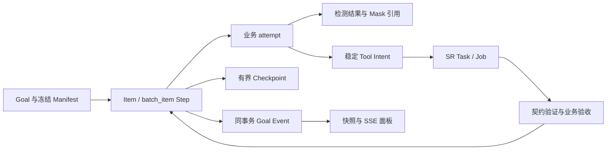
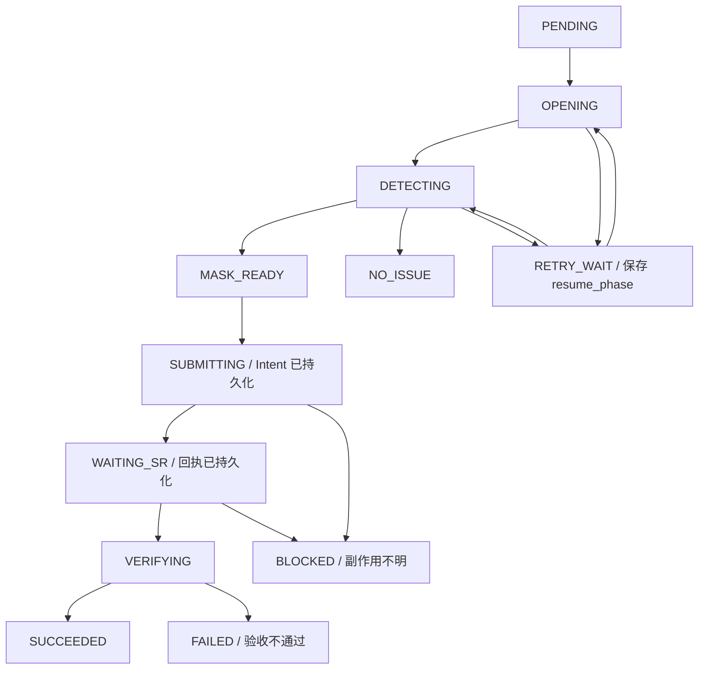

# Durable Goal Harness P0 与 Batch Artifact Repair Workflow v2 实施计划

> 更新：2026-11-06 · 状态：合并计划；F 的本地实际后端 + Fake SR 联合验收已完成，实施与验收状态以对应 status 文档为准。
> 本文件统一 Harness P0 与 Batch v2 要求，两者是基础能力与业务流水线的依赖关系。
> 2026-11-02 的工作仅合并、复审和细化计划；后续本地实施记录见各阶段 status。真实生产作业及准入未授权、未开放。

## 任务导航与当前优先级

最新增量：共享真实差异检测、Batch Mask 与逐区域人工质量审核已完成本地实施和测试，见 [实施与边界](../status/batch-human-quality.md)。M4 内网单景真实 SR 联验仍未完成，production 提交门保持关闭；不能将 50 景 Fake 或本地人工审核联测视为生产准入。

| 范围 | 当前状态 / 入口 | 下一步与退出条件 |
| --- | --- | --- |
| Harness P0（P0-0～P0-7） | 已有实现，未全量收口；见 [P0 差距复核](../status/p0-gap-review.md) | 按差距补齐，不从零重做；满足第一部分验收 |
| Batch PR A：基础设施 | 已实施，见 [PR A/B 实施记录](../status/batch-pr-ab.md) | M0 复核契约、Fake 生命周期与真实环境边界 |
| Batch PR B：Manifest / Item | 已实施；混合调度饿死与 Manifest 完整性两项 P1 已修复、待复核 | M0 复核冻结、幂等、原子创建及 C 所需数据 |
| Batch PR C：Producer / Monitor | 后端与测试已实施；复审 P1（提交边界复核、容量死锁收口）与 P2（Monitor 查询窗口）已关闭，待复核。见 [PR C 实施记录](../status/batch-pr-c.md)；演示入口与 Panel 归 PR F | M1 后端语义：上一景运行时下一景已开始；真实检测/Verifier 归 PR D/E |
| Batch PR D / E：算法 IO / SR 生命周期 | 已实施，见 [D](../status/batch-pr-d.md)、[E](../status/batch-pr-e.md)；production 提交门关闭 | M2 的本地真实 Mask / Overlay 与 50 景 Fake 生命周期已验证；真实质量准入待内网 |
| Batch PR F：进度 Panel 与用户入口 | M3 演示退出条件已达成；沿用现有双 Tab 任务中枢，详见 [F §12](../status/batch-pr-f.md#12-入口接线正确性补修与实际后端联合验收2026-11-06) | 50 景浏览器 → 实际 Batch 后端 → 独立 Fake SR 已通过；物理提交 50 / 重复 0，事件与报告一致；下一步为 M4 真实环境准入 |
| 故障与生产准入 | 真实 SR/GPU 尚待内网验证 | M4：故障注入通过，再小规模内网试运行 |

阅读顺序：先看本节、第二部分 K 的首次开发约定与 H 的 M0–M4，再按 A–F 推进；第一部分作为基础契约和 P0 缺口依据。G 是跨阶段要求，I 是统一验收清单，J 是开发前待细化的交付清单。K 对 A–J 中未明确的细节作具体约束；涉及现有源码的描述以所列文件为核对入口。

### 范围与冲突处理

- 合并完成后的下一项工作是 J 所列源码对照与计划细化；不能把文档合并视为 M0 审计通过。
- 第一部分“实施”要求适用于后续 P0 补齐阶段；第二部分“只更新计划”适用于计划细化阶段。开始 C–F 编码前先明确文件清单、契约、风险与验收证据。
- P0 的依赖步骤仍须等待并验收前置结果；Batch 的不同景无此依赖时，提交回执持久化后立即处理下一景，Monitor 独立验收。不能把整个批次停在首个 WAITING_SR。
- 保留 A/B 已有成果；“已实施”不等于“已通过生产验收”。建议模块、状态与配置在实现前核对源码，不作为已存在能力。
- DONE 仅为批量业务阶段；Goal 的 COMPLETED 仍须独立 Verifier。Mock / Fake 结果须保留来源标识。
- 当前生产路线为 SR_EXECUTOR=local，真实 local 单槽、默认 inflight=1；Fake 可提高并发。local 重启后状态不明可安全阻断，不能承诺自动恢复或盲目重投。
- 统一遵守离线 vendor、受控路径、禁止扫盘、大图内存与 Canvas 上限；真实数据只在内网，不触发生产 SR/GPU，保留现有未提交修改。
- Pi 只作设计参考，源码研究路径须核对实际版本；本次合并不新增对外部项目能力的验证结论。

## 第一部分：Harness P0 基础能力与验收

本部分保留原 P0 需求及安全边界。完成度见 [P0 差距复核](../status/p0-gap-review.md)，恢复与执行口径见 [Durable Goal Runtime](../status/durable_goal_runtime.md)。

### 一、任务背景与总体目标

目标项目：

https://github.com/Jason001028/sr_agent_platform

参考项目：

https://github.com/earendil-works/pi

本次任务不是重写 Agent 框架，也不是简单复制 Pi 的代码，而是在充分理解两个项目的源码后，对现有 `sr_agent_platform` 进行增量改造，使其从「能够调用工具的交互式 Agent」升级为「具有持久化执行、自动续跑、外部作业等待、崩溃恢复和业务验收能力的 Agent Harness」。

**P0 的核心验收目标：**

1. 用户提交长期任务后，即使关闭浏览器，任务仍能够在后端自主推进。
2. FastAPI 服务或 Worker 重启后，能够从已持久化的安全恢复点继续，而不是从头执行。
3. Agent 提交 SR 作业后，可以自动等待作业完成，并在获得真实终态后继续执行后续步骤。
4. SR 作业失败、超时或状态不确定时，能够正确分类处理，禁止未经确认的重复提交。
5. Agent 的自然语言回复不等于业务任务成功。任务必须经过独立的确定性验收。
6. Agent 连续执行时具有明确的轮次、重试和资源预算，避免无限循环。
7. 所有关键执行行为能够被审计，并为未来 SFT 数据建设积累高质量轨迹。

**开发原则：先保证正确性，再实现无人值守，最后优化执行效率。**

本部分定义 Harness P0 基础范围；已有实现按差距复核补齐，不重复建设。Todo、复杂 Planning、Context Compaction、多 Agent、完整 Skill Runtime 和 SFT 训练均不属于本次主要开发范围，但需要保留合理扩展点。

---

### 二、技术约束与改造边界

必须保留项目现有的主要技术栈：

- Python + FastAPI 后端。
- SQLite 持久化体系。
- Vue3 前端。
- 自研 Agent Loop 与工具注册体系。
- OpenAI 兼容的 `/v1/chat/completions` 推理接口。
- 现有 SR 算法、任务提交、执行器、作业查询及结果判定链路。
- CentOS 7 内网离线部署环境。

平台后端与 SR 算法可能使用不同 Python 环境，应核对并保持其现有解释器隔离与依赖兼容性。不得因为 Harness 改造而改变 SR 生产算法运行环境。

禁止：

1. 引入 LangChain、LangGraph 或其他大型 Agent 框架替换现有实现。
2. 直接移植 Pi 的 TypeScript Runtime。
3. 重写 SR 核心算法或改变现有生产输出契约。
4. 为 Agent 开放不受控制的 Shell、文件删除或任意路径写入能力。
5. 用增加 `max_turns` 或简单的无限循环替代持久化任务调度。
6. 依赖前端页面保持连接来维持长期任务。
7. 将模型输出的「任务完成」直接作为业务成功依据。
8. 在外部作业状态 UNKNOWN 时直接重试提交。
9. 为了实现 P0 而大规模重构当前稳定的聊天、影像查看及 SR 管理功能。

优先复用已有代码。新增模块应遵循当前仓库命名规范、事务风格、配置方式和测试结构。

必须提供 Feature Flag 或兼容性开关，使新 Goal Runtime 能够逐步接入，而不直接破坏原有聊天执行路径。

---

### 三、第一阶段：源码研究与差距审计

正式修改代码前，必须完成两个仓库的源码审查。

#### 3.1 研究 Pi 的关键模块

优先阅读：

- `packages/durable/README.md`
- `packages/durable/src/harness/tool.ts`
- `packages/durable/test/examples/13-recovery.ts`
- `packages/agent/src/agent-loop.ts`
- `packages/agent/src/harness/execution/tools.ts`
- `packages/coding-agent/src/core/agent-session.ts`
- `packages/coding-agent/src/core/session-manager.ts`

必要时继续追踪 Durable Runtime 的 Task、Checkpoint、Wake、Retry、Storage 和 Recovery 相关实现。

研究重点：

**A. Durable Task**

理解 Pi 如何定义可恢复任务、保存 Checkpoint、处理中断并重新调度。

**B. ToolTask 与安全重放**

重点研究执行意图记录、工具重放策略、已执行副作用和未确认结果的处理方式。

**C. Sleep / Wake / Parked**

研究长期等待如何持久化，以及服务重启后如何继续调度、如何避免重复崩溃形成无限恢复循环。

**D. Agent Loop**

研究 Turn 生命周期、工具结果回灌、`finishTurn`、`prepareNextTurn` 和有限轮次执行。

**E. Session Manager**

研究会话历史如何保存、重新加载和恢复，但不要求照搬其 JSONL 存储方式。

注意区分：

- Pi 源码中确实存在的功能。
- Pi 官方仅作为 Experimental 提供的功能。
- 本项目需要自行实现的业务特化机制。

不得将 Pi 并不存在的能力归因于 Pi。

#### 3.2 审查 sr_agent_platform

优先检查以下路径，实际文件存在性及调用关系以当前仓库为准：

- `AGENTS.md`
- `README.md`
- `backend/agent/loop.py`
- `backend/services/store.py`
- `backend/services/trajectory.py`
- `backend/services/run_sr.py`
- `backend/services/local_exec.py`
- `backend/services/slurm.py`
- `backend/tools/sr_job_status.py`
- `backend/tools/contract.py`
- `backend/api/platform.py`
- SR 结果判定文件生成及读取代码。
- 前端 SSE、聊天和 SR 作业管理相关模块。
- 当前自动化测试。

重点确认：

1. 当前 Agent Loop 的消息提交、工具执行和恢复边界。
2. `resume=True` 是否仅能恢复会话，还是具备独立任务自动调度能力。
3. 工具调用是否存在先执行副作用、后保存意图的故障窗口。
4. 当前 SSE 断连是否影响任务执行生命周期。
5. `sr_job_status`、`run_sr`、本地执行器及队列 API 是否使用一致的作业状态来源。
6. `sr_tasks.fingerprint` 的唯一性约束、生成依据与去重语义。
7. FAILED、UNKNOWN、COMPLETED、SKIPPED 等状态的实际定义。
8. 判定文件与业务产物验证的现有代码。
9. `trajectory_events` 是否足以关联 Goal、Step、Tool 与 External Job。
10. 当前数据库连接及事务模型是否支持独立后台 Worker。

**第一阶段必须产出：源码差距审计表。**

每项包含：

- 当前实现路径。
- 已存在能力。
- 缺失能力。
- 关联风险。
- 推荐复用方式。
- 必须新增的最小代码。

后续进入 P0 实施时，完成审计后按差距补齐；本次合并不启动代码实施。

---

### 四、P0 开发任务与顺序

以下为 P0 基础能力的依赖顺序；已实现项先核查，未满足项再补齐，形成独立、可回归的阶段。

#### P0-0：修复并统一 SR 状态查询

**目的：为整个 Durable Runtime 建立可信的外部状态来源。**

检查 `sr_job_status` 是否绕过现有 SR 执行器路由，直接查询不适用的调度后端。

优先复用现有 `run_sr.query_job_status()` 或仓库内实际等价的统一查询服务。

要求：

- 根据 `job_id` 找到对应 `sr_tasks`。
- 正确查询 `SR_EXECUTOR=local` 的任务。
- 兼容现有其他执行器，但不新增无必要的调度依赖。
- 复用原有判定文件、进程状态及作业结果契约。
- 明确 ACTIVE、COMPLETED、FAILED、SKIPPED、UNKNOWN 的语义。
- 区分 SR 契约完成和业务产物真正达标。
- Agent 查询结果与队列 API 对同一个作业的判断保持一致。
- 不复制第二套独立的 SR 终态判定逻辑。

验收：

相同 `job_id` 经工具接口与队列接口查询，应获得一致且可解释的业务状态。判定文件缺失不能被默认解释为成功。

#### P0-1：新增 Durable Goal 数据模型

**目的：让业务任务拥有独立于聊天会话和 HTTP 请求的持久化生命周期。**

推荐逻辑层级：

`Goal → Round → Turn → Tool Call → External Job`

其中：

- Goal：用户真正希望完成的长期业务任务。
- Round：具有有限执行预算的一次 Agent 推进。
- Turn：一次模型输出及其工具调用。
- Tool Call：具体工具执行。
- External Job：独立持续运行的 SR 作业。

上述层级是逻辑关系，不要求每一层立即单独建表。

建议在现有 SQLite 中建立：

`agent_goals`

保存 `goal_id`、`session_id`、状态、阶段、Checkpoint、版本、租约、下一次唤醒时间、执行预算及错误信息。

`agent_goal_steps`

保存任务步骤、执行状态、工具关联、外部作业关联和业务验证结果。

`agent_tool_intents`

保存工具名称、规范化参数、稳定幂等键、执行意图、重放策略、外部 Job ID、结果及尝试次数。

`agent_goal_events`

保存可重放的 Goal 生命周期事件，包含单 Goal 严格递增的序号。

具体表名应与仓库约定协调，避免与已有表重复。

设计要求：

- 状态转移必须经过明确规则。
- 关键状态与事件更新在同一 SQLite 事务中提交。
- 支持 `version` 或等效并发控制。
- 固定的、需要索引和查询的业务字段不得全部塞入 JSON。
- 现有数据库必须支持安全增量迁移。
- 不删除已有 `sessions`、`messages`、`agent_runs`、`trajectory_events` 和 `sr_tasks`。
- Checkpoint 仅保存恢复所需事实，不保存大量无关聊天内容。

推荐 Goal 状态：

`QUEUED`、`RUNNING`、`WAITING_EXTERNAL`、`VERIFYING`、`RETRY_WAIT`、`PAUSED`、`BLOCKED`、`COMPLETED`、`FAILED`、`CANCELLED`。

要求定义合法状态转移及每个状态的进入条件、恢复条件、退出条件。

验收：

数据库重新打开后，能够恢复完整的 Goal 身份、执行阶段、Checkpoint 和待处理的工具意图。

#### P0-2：Tool Intent Ledger 与副作用恢复保护

**目的：避免崩溃、重试及重复请求造成未经授权的 SR 重复提交。**

借鉴 Pi Durable ToolTask 的执行前持久化和安全重放原则，在现有工具执行入口增加轻量级 Tool Guard。

工具按性质分类：

- `READ_ONLY`：只读，允许按策略重放。
- `IDEMPOTENT_EFFECT`：存在经过验证的幂等执行语义。
- `RECONCILE_REQUIRED`：外部副作用，需要先对账。
- `APPROVAL_REQUIRED`：高风险操作，必须经过明确授权。

每次有副作用的工具执行遵循：

1. 规范化工具参数。
2. 生成稳定的业务操作标识。
3. 在数据库中保存执行意图。
4. 提交外部操作。
5. 持久化外部调用标识和结果。
6. 通过真实外部状态进行核查。
7. 最后推进 Goal 阶段。

注意：SQLite 与外部 SR 调度器不存在天然的跨系统原子事务。

尤其需要处理：

**SR 已接受任务，但 API 在保存 Job ID 之前崩溃。**

恢复时必须先根据稳定业务标识、现有任务记录及可用外部查询机制进行对账。

若无法确认原作业是否已提交，必须进入 `BLOCKED` 或等价的安全停止状态，不得再次盲目提交。

工具幂等键应基于规范化业务参数和明确操作语义设计，不能简单等于随机 Tool Call ID。应区分重复请求与用户明确授权的再次执行。

需要核查并修复现有 UNKNOWN 状态可能导致再次提交的风险。

验收：

在覆盖的故障注入场景中，不出现未经授权的重复 SR 物理提交。对于外部状态无法核实的情况，允许安全阻断，不得伪造恢复成功。

#### P0-3：Goal-Round Driver 与后台自动续跑

**目的：将 Agent 的交互式执行转换成可持久化调度的长期任务执行。**

保留现有 `backend/agent/loop.py` 的模型调用及工具执行能力。

新增一个轻量执行适配层，例如：

`agent/round_executor.py`

以及独立 Goal Runtime，例如：

`services/goal_runtime/`

建议内部职责分离为：

- `models.py`：状态与数据结构。
- `repository.py`：事务与持久化。
- `driver.py`：Goal 推进和 Round 调用。
- `scheduler.py`：调度、领取及唤醒。
- `recovery.py`：重启恢复与错误分类。
- `tool_intent.py`：副作用意图与对账。
- `events.py`：持久化事件。

这是建议结构，可根据现有代码合理合并，不为追求文件数量而拆分。

单次 Round 必须有有限预算，结果至少区分：

- `CONTINUE`
- `WAITING_EXTERNAL`
- `NEEDS_APPROVAL`
- `COMPLETED_CANDIDATE`
- `FAILED`

`COMPLETED_CANDIDATE` 仅表示模型认为任务已完成，不能直接更新为 `COMPLETED`。

后台 Worker 必须：

- 独立于 HTTP 请求和 SSE 订阅执行。
- 使用 SQLite 原子领取与 Worker Lease。
- 支持长时间执行时续租。
- 使用版本或 fencing token 防止旧 Worker 覆盖新状态。
- 在启动时扫描并恢复非终态任务。
- 支持持久化 `next_wake_at`。
- 禁止同一 Goal 的非预期并行执行。
- 不因浏览器断开而取消目标。
- 不因 Worker 租约过期而直接重放外部副作用。

对于可能执行数十分钟的 SR 作业：

1. 提交成功后保存关联 Job ID。
2. Goal 进入 `WAITING_EXTERNAL`。
3. Worker 释放当前计算调度占用。
4. 由确定性代码定期查询或事件唤醒。
5. 尚未完成时更新下次唤醒时间，不调用 LLM。
6. 检测到明确终态后恢复后续 Agent 决策。

不允许使用无限 LLM 循环实现挂机。

同时修复现有 `run_loop()` 中任何经审计确认的未闭合工具调用恢复问题，确保合成恢复结果不会在多次重启时重复产生不一致历史。

验收：

关闭浏览器后 Goal 继续推进；重启 Worker 后从安全 Checkpoint 恢复；SR 等待期间不产生无意义的 LLM Token 消耗。

#### P0-4：Recovery、Retry 与基础熔断

**目的：让系统既能自动恢复，也能在无法安全恢复时正确停止。**

至少区分：

- 模型 API 短暂异常。
- 模型推理服务不可用。
- 工具参数错误。
- 外部任务正在执行。
- 外部任务明确失败。
- 外部任务状态不确定。
- 业务产物验收失败。
- Worker 崩溃或租约失效。
- 用户取消或暂停。
- 运行预算耗尽。

基础设施可恢复故障使用有限重试和指数退避。

外部业务副作用不得直接套用模型 API 的自动重试规则。

重复发生同一确定性故障时，触发熔断或任务停放，防止持续消耗 GPU、Token 或业务资源。

至少引入：

- 单 Round 最大 Turn 数。
- 单 Goal 最大模型调用数。
- 基础设施重试上限。
- 连续异常恢复次数上限。
- 可选任务运行截止时间。
- 基础暂停、恢复和取消语义。

暂停或取消 Goal，不应默认强杀已经提交的 SR 生产作业；是否取消真实 SR 作业必须依据现有执行器能力及明确授权。

验收：

确定性故障不会造成无限自动重试；已提交的外部作业不会因 Goal 暂停而意外消失。

#### P0-5：SR Goal Verifier

**目的：让业务真实结果决定 Goal 是否完成。**

增加独立的 Goal Verifier，统一负责长期业务目标的完成判定。

至少区分：

1. 工具调用成功。
2. SR 作业提交成功。
3. SR 作业执行终止。
4. SR 执行契约通过。
5. 用户目标的业务验收通过。

这些状态不等价。

复用现有 SR 判定文件和产物验证机制。

对于现有类似 `verdict=0`、`skip=1`、`verdict=90` 的语义，应先核对源码中的真实契约，再映射到业务验收结果。

如果作业合法跳过，不应错误宣称已经生成影像产品。

Goal Verifier 应根据目标定义检查：

- 必要外部作业是否达到可信终态。
- 所需产物是否存在且满足现有业务契约。
- 是否有遗漏的未完成步骤。
- 是否存在尚待确认的错误或副作用。
- 用户原始任务要求是否已经满足。

只有通过验证后才允许将 Goal 标记为 `COMPLETED`。

验收：

模型提前总结、工具仅返回 Job ID、SR 进程退出但产物不合格，均不会被错误判定为业务目标成功。

#### P0-6：Goal API、SSE 事件恢复与最小前端适配

**目的：将长期任务执行与前端交互生命周期解耦。**

在现有 API 命名体系下增加：

- 创建 Goal。
- 查询 Goal 状态和 Checkpoint。
- 查询历史事件并按序号增量回放。
- 订阅 Goal 实时事件。
- 暂停 Goal。
- 恢复 Goal。
- 取消 Goal。
- 查询待人工确认事项。

必要时增加审批接口，但不要求本阶段建设完整的通用审批系统。

Goal 创建接口必须支持请求级幂等键，避免重复 HTTP 请求创建多个相同目标。

事件包含：

`goal_id`、`seq`、`event_type`、`created_at`、相关 `run_id` / `step_id` 及必要状态信息。

前端沿用现有 Vue3 的聊天和工具调用卡片设计，只增加必要的长期任务展示。

至少显示：

- 当前 Goal 状态。
- 任务正在执行、等待外部 SR、恢复中或需要人工确认。
- 已完成与待完成步骤。
- 当前关联作业。
- 已确认的失败原因。
- 刷新或重连后的任务恢复状态。

前端显示必须来自真实后端状态，不允许依靠本地模拟推进。

验收：

关闭、刷新、重新打开浏览器后能够恢复 Goal 当前状态与历史事件，且不会导致任何额外工具执行。

#### P0-7：自动化测试、故障注入与固定验收集

**目的：通过确定性测试证明 Harness 的可靠性。**

首先建设 Mock LLM、Fake SR Executor 和可控制的崩溃注入机制。

至少覆盖以下场景：

1. 意图入库后、外部执行前进程退出。
2. 外部 SR 接受提交后、Job ID 入库前进程退出。
3. Job ID 已保存，等待期间重启。
4. SR 已完成但 Goal 尚未更新时重启。
5. 相同 Goal 创建请求重复发送。
6. 两个 Worker 同时领取同一个 Goal。
7. 租约过期后旧 Worker 尝试写入状态。
8. 浏览器关闭后 Goal 仍持续推进。
9. SSE 断线后事件按序号恢复。
10. LLM 服务暂时不可用后恢复。
11. 重复确定性错误触发熔断。
12. Goal 暂停、恢复及取消不意外改变 SR 作业。
13. SR 提交成功但业务产物验收失败。
14. 预算耗尽后安全停止。
15. SR 状态 UNKNOWN 时不得盲目重新提交。
16. `skip=1` 等合法跳过情形不得被误报为产品生成成功。
17. 当前普通聊天和 SR 队列流程无回归。
18. SQLite 旧数据库可以完成迁移。

随后构建约 30–50 个固定任务的验收集，优先使用 40 个左右覆盖正常执行、等待、幂等、重启恢复、异常处理与多步骤目标的案例。

必须输出以下指标：

- Goal 完成率。
- 无人工介入完成率。
- 安全可恢复任务的恢复成功率。
- 未经授权的重复 SR 提交次数。
- 错误完成判定次数。
- UNKNOWN 盲重试次数。
- 单任务平均模型请求数。
- 单任务 Token 消耗。
- 平均完成时间。
- BLOCKED 原因分布。

对于固定确定性测试集，目标是重复副作用为 0、错误成功判定为 0、UNKNOWN 盲重试为 0。

测试不能只依赖真实 LLM 的随机输出。先通过确定性 Mock 与故障注入，再执行真实 LLM、真实 SR 的小规模集成验证。

---

### 五、为后续 P1 与 SFT 保留扩展点

P0 暂不开发完整 Todo、Context Compaction 和多 Agent Runtime，但必须为它们预留合理的数据结构。

未来 Todo 应关联持久化 Goal Step，不应只作为一段 Markdown。

未来 Context Compaction 只能压缩模型上下文，不能替代数据库中的真实业务状态。

需要永久保留的关键事实包括：

- Goal 身份与原始目标。
- 已完成和未完成步骤。
- 外部 Job ID。
- 任务指纹和幂等键。
- SR 判定结果。
- 业务输出路径及必要参数。
- 未经确认的副作用。
- 用户审批与约束。

现有 `trajectory_events`、`messages` 和 `agent_runs` 应尽量复用。

本次只增加必要的关联和元数据，使未来能够抽取：

- 成功的工具调用轨迹。
- 失败后的正确恢复决策。
- 人工纠正样本。
- 真实业务终态与验证结果。
- 对应的模型、Prompt 和工具契约版本。

避免重复记录大量无意义日志，并遵守已有敏感字段脱敏策略。

不得把未经审核的原始轨迹直接作为 SFT 正确标签。

---

### 六、实施方式与交付要求

建议按以下阶段推进：

| 阶段 | 工作内容 | 关键交付 |
|---|---|---|
| 0 | 双仓库源码审计、修复 SR 状态查询 | 差距清单、统一状态接口 |
| 1 | Goal 数据模型及 Tool Intent | Migration、事务、恢复保护 |
| 2 | Goal-Round Driver 和 Scheduler | 后台独立执行、Sleep/Wake |
| 3 | Recovery、Retry、Goal Verifier | 重启恢复、可靠业务验收 |
| 4 | Goal API 和前端最小接入 | 可重连、可观察的执行状态 |
| 5 | 故障注入及验收 | 测试结果、性能基线、回归报告 |

每阶段应尽量具有独立的代码变更和测试，不要一次性重写整个仓库。

每完成一个阶段，必须报告：

1. 实际修改和新增的文件。
2. 核心实现及状态转移。
3. 复用现有代码的部分。
4. 借鉴 Pi 源码的具体设计及其路径。
5. 执行过的测试命令。
6. 测试通过情况。
7. 未解决的风险。
8. 下一阶段的依赖。

不要把设计稿、伪代码或未运行的测试宣称为完成的实现。

遇到现有源码与本任务假设不一致时，应优先尊重实际代码和既有业务契约，记录差异并作最小可行调整，不应强行套用预设架构。

**工作模式要求：**

- 后续进入代码实施阶段后，完成必要审计即按差距清单开发；本次合并只整理文档。
- 优先确认 P0-0、P0-1 和 P0-2 的现有实现及缺口，因为后续自动运行依赖可信状态与副作用保护。
- 每个阶段完成后运行相应测试，再推进下一阶段。
- 可以合理调整内部实现细节，但不得降低关键安全要求。
- 如果缺少真实内网运行环境，使用 Mock 完成可验证部分，并明确列出仍需内网验收的项目。
- 不要为了追求架构完整性而引入与 P0 无关的复杂抽象。

---

### 七、最终验收标准

本次 P0 是否成功，不以新增代码量、重构规模或模型连续调用次数衡量，而以真实业务任务的可靠执行能力衡量。

典型验收场景：

用户创建一个包含 12 景遥感影像处理步骤的 Goal。

Agent 自动选择并提交 SR 作业，在作业运行期间进入持久化等待。

用户关闭浏览器。

FastAPI 服务随后重启。

某次模型推理请求发生短暂异常。

系统能够通过已持久化的 Goal、Checkpoint、Tool Intent 和 SR 真实状态恢复任务。

不会因为重启重新提交仍在运行的 SR 作业。

已经完成的步骤不被错误重复执行。

SR 达到终态后，系统独立核查判定文件和必要产物。

存在结果依赖的后续步骤须等待前置验收；Batch 中无依赖的下一景可在上一景提交回执持久化后推进，见第二部分 C/E。

全部步骤完成并通过 Goal Verifier 后，Goal 才进入 `COMPLETED`。

如果某个外部作业真实状态无法确认，系统安全进入 `BLOCKED`，明确展示问题，而不是盲目重试。

用户重新打开网页时，可以查看完整任务进度、已完成步骤、等待状态及执行结果。

**最终交付：一套基于现有 FastAPI + SQLite + SR 执行链路的小型 Durable Goal Runtime，以及能够自动化验证其可靠性的 P0 测试体系。**

实施重点是可靠执行和业务闭环，而不是移植完整 Pi 框架。

---

## 第二部分：Batch v2 异步流水线（PR A–F）

### 0. 总体目标与设计原则

目标仓库：`sr_agent_platform`

参考：`earendil-works/pi`，重点研究 Durable Task、ToolTask Replay Policy、Sleep/Wake、Agent Loop Hooks、Compaction。

后续细化计划时，先审查当前本地工作树、[PR A/B 实施记录](../status/batch-pr-ab.md)及相关源码，按 J 节补齐设计证据。

**本部分定义 Batch v2 后续任务。本次仅合并计划；保留 A/B 成果，不启动 C–F。**

目标是在现有 FastAPI + SQLite + Vue3 + Agent Loop + Goal Runtime 基础上，实现：

**导入任务文档 → 创建 Batch Goal → 逐景检测 → 生成 Mask → 提交 SR → 立即处理下一景 → 异步等待多个 Job → 独立验收 → 汇总结果。**

本阶段以可运行的 Demo 为优先交付，检测可以采用 Mock，但业务 IO、状态推进、异步执行、持久化、Job 关联与 Viewer 展示必须真实。

核心原则：

1. **LLM 负责决策，确定性 Workflow Driver 负责执行。** 不让 LLM 对每张图重复规划相同流程。
2. **Producer 不等待 SR 完成。** 只需完成提交及可靠回执记录，下一景即可开始。
3. **Monitor 独立于 Producer。** 后台查询已有 SR Job，完成后触发验证与进度更新。
4. **数据库是事实来源。** 浏览器、聊天历史和模型上下文都不能代替持久化业务状态。
5. **执行有限、可恢复、可审计。** 不依赖无限循环、无限重试或长期保持 LLM 请求。
6. **先复用，后扩展。** 不重复开发已存在的 Goal、Tool Intent、SR 状态查询、SSE、Viewer 和空间批注。
7. **真实与 Mock 严格隔离。** 不以模拟结果宣称真实算法或生产 SR 验收成功。

---

### A. 基础设施与契约清障

**状态：据 PR A/B 实施记录已实施；M0 仍需复核，不重复开发。**

当前已报告完成：

- Fake SR 修复产物符合 `verify_sr_run._check_repair()` 预期。
- 会话标题模型调用与 Goal 模型预算隔离。
- 子进程启动等待预算调整。
- local 执行、容量、NoData、配对边界已记录。

优化要求：

1. 再次检查 Fake 修复产物与真实 Verifier 的文件名、配置摘要、判定文件及成功语义一致性。
2. 核查 `title-model` 隔离是否存在生命周期、超时或线程资源泄漏。
3. 保留现有统一 SR 状态查询、Tool Intent、UNKNOWN 对账、Lease/Fencing 和可信 Verifier。
4. 明确 SR Mask 输入契约：路径、尺寸、位深、前景/背景值、坐标、NoData、输出目录和产物命名。
5. 将无法在本地验证的 GPU、Slurm、真实 SR 算法能力记录为后续内网准入条件。

**A 阶段退出条件：** 既有 Goal/SR 契约无阻断性缺陷，Fake Executor 能在隔离测试环境提供真实可查询、可验证的模拟作业生命周期。

不得为了新 Batch 功能改变生产 SR 的现有输出契约。

---

### B. Batch Goal / Manifest 与数据基础

**状态：据 PR A/B 实施记录已实施；重点复核 C 所需字段与事务能力，异步流水线尚未完成。**

当前已报告完成：

- `batch_manifest.py`：编码兼容、逐行诊断、去重、PAN/NOSR 配对、内容冻结及排除规则。
- `scene_resolve.py`：统一场景解析服务。
- `store.py`：Step 增加 `kind/item_id/checkpoint/version/resource_key/next_wake_at`，支持旧库迁移及原子创建。
- `goal_runtime.py`：Batch 导入、创建及 Items 查询 API。
- `goal_worker.py`：PR C 之前 Batch Goal 停放隔离。

优化重点：

**B1. 固定 Manifest 身份**

Manifest 必须具有稳定内容摘要。创建后不允许因原始文件变化而悄然改变执行内容。

每个 Item 必须有稳定身份，建议逻辑关系：

`goal_id + item_id + attempt_id`

每次检测、Mask、SR 提交及验收都能回溯到对应 Item 和尝试轮次。

**B2. 为独立调度预留必要数据**

核查现有 Step 是否足以表示：

- 当前业务阶段。
- 检测结果引用。
- Mask 文件引用及摘要。
- 当前外部 SR Job ID。
- 重试次数。
- 下次唤醒时间。
- 当前错误与阻断原因。
- 乐观锁版本。
- 资源占用及必要的来源标识。

只补实际缺少的字段，不重复设计一套 `batch_items` 表。

**B3. 明确事务边界**

- Goal 与全部 Item 原子创建。
- 同请求幂等键 + 同内容返回既有 Goal。
- 同键异内容返回冲突。
- Item 状态与对应事件应原子持久化。
- 创建失败不能留下孤立 Step。
- 旧 Goal/Step 不受新 Batch 字段影响。

**B 阶段退出条件：** 50 景 Manifest 能一次创建、查询、冻结和恢复，每景具备可独立推进的持久化业务状态。

---

### C. Producer / Monitor：长任务循环执行核心

**这是本轮最重要的后端阶段。**

#### C1. 采用两个逻辑执行职责，而不是两个重复的 Runtime

Producer：

`CLAIM_ITEM → OPEN → DETECT → BUILD_MASK → SUBMIT_SR → PERSIST_RECEIPT → NEXT_ITEM`

Monitor：

`QUERY_PENDING_JOBS → RECONCILE → VERIFY_OUTPUT → UPDATE_ITEM → WAKE_OR_FINISH`

优先复用现有 `goal_worker.py`、Goal Repository、Lease、Checkpoint 与 `next_wake_at`。

Producer 与 Monitor 可以作为同一个 Worker 内的两个调度职责运行，但不得要求一个长时间运行的 HTTP 请求负责整个生命周期。

如果需要并发执行，应保持明确的 Item 领取所有权和数据库状态写入边界，不创建没有持久化身份的任意后台线程。

#### C2. 有限执行，持久化续跑

每次调度只推进有限数量的 Item 或有限耗时，随后提交 Checkpoint，并按实际待处理工作决定继续或唤醒。

要求：

- 无待处理 Item 时停止 Producer。
- 有待完成 Job 时继续 Monitor。
- 有新 Item 时不因为其他 Item 等待 SR 而停止。
- 服务重启时，根据持久化状态恢复。
- 已完成步骤不重复执行。
- 外部状态未知时不盲目重提。
- 不在持有长时间 SQLite 写事务期间执行检测、文件 IO 或外部请求。

#### C3. 并发与背压

增加或复用配置：

- `max_inflight_sr_jobs`：同时未完成 SR Job 上限。
- `max_prepared_items`：已经生成 Mask、等待提交的 Item 数量上限。
- `max_detection_concurrency`：同时运行的检测任务上限。
- `max_attempts_per_item`：单景最大尝试次数。
- `monitor_poll_interval`：SR 状态轮询间隔。

默认采用保守值；Fake Executor 可提高并发用于演示，但生产值必须依据执行器容量确定。

达到 SR 容量时，允许 Producer 继续预处理有限数量的后续 Item；达到准备队列上限后实施背压，不无限积累 Mask 和大图内存。

Monitor 不得因 Producer 忙碌而长期无法查询已完成 Job。调度应兼顾公平性，避免任何一条链路被饿死。

#### C4. 任务状态语义

单景 Item：

`PENDING → OPENING → DETECTING → MASK_READY → SUBMITTING → WAITING_SR → VERIFYING → SUCCEEDED`

分支：

`NO_ISSUE / RETRY_WAIT / FAILED / BLOCKED / SKIPPED`

整批 Goal 复用已有状态枚举，增加必要的业务 `phase`：

- `DISPATCHING`：仍有 Item 在准备或提交。
- `DRAINING`：已无新提交，但存在未完成 SR Job。
- `VERIFYING`：处理剩余产物验收及汇总。
- `DONE`：所有 Item 均已达到可汇总终态。

`DONE` 是业务阶段，不是 Goal 的成功终态。只有可信 Verifier 满足目标条件，才能进入现有 `COMPLETED`；存在失败或阻断时必须如实呈现部分完成或阻断结果。

#### C5. “打开影像”的实际语义

不能依赖 Vue 页面自动点击下一张图来实现后台任务循环。

后端 `OPENING` 应表示完成影像来源解析、文件可访问性检查、必要元数据读取及处理输入准备。

Viewer 在线时可自动跟随 Producer 当前 Item；用户正在手动查看其他影像时，不应强制抢占其画面。允许设置“自动跟随当前任务”。

**C 阶段最小验收：**

无需 D/E/F 全部完成，先利用 Stub Detector、Stub Mask 和 Fake SR 实现 5 景异步纵向切片。必须从 M1 起接入 Intent、持久化回执与独立验收边界；不能先做无保护的提交，再留给 E 阶段补安全机制。Stub Mask 也必须符合 Fake 执行与验收所需的最小文件契约。

必须证明：第 1 景 Job 仍在运行时，第 2 景已经进入检测；关闭浏览器或重启 Worker 不影响推进；没有重复物理提交。

---

### D. Detector / MaskBuilder：可替换算法 IO

**优先完成真实 IO，暂不追求检测精度。**

#### D1. Detector 契约

统一接口：

`detect(image_ref, reference_ref, config) -> DetectionResult`

标准结果至少包含：

- `item_id`
- `image_id`
- `image_size`
- `coordinate_space`
- `candidates`
- `detector_name`
- `detector_version`
- `provenance`
- `diagnostics`

候选区域支持 BBox / Polygon，预留 `artifact`、`local_blur` 等类型。

首版实现确定性 `MockDetector`：根据固定 Fixture 返回预先定义的异常区域，不使用随机坐标伪装真实检测。

后续 OpenCV / 分割模型必须实现同一接口，不修改 Workflow Driver。

#### D2. MaskBuilder 契约

统一接口：

`build_mask(detection_result, source_metadata, config) -> MaskResult`

要求：

- 真正生成可读取的二值 Mask 文件。
- 保持源影像尺寸及像素坐标语义。
- 验证前景/背景值、数据类型、NoData 和必要地理参考。
- 输出不可变的 Mask 文件引用、摘要和版本。
- 生成用于 Viewer 的轻量 Overlay。
- 所有输出限制在受控目录内。
- 失败时返回明确错误，不使用空 Mask 冒充正常成功。

MaskBuilder 与 Detector 解耦，后续更换检测算法不影响 SR 提交接口。

#### D3. Viewer 适配

复用现有 ROI、Mask、空间批注和图像坐标转换能力。

要求：

- 可显示当前模拟检测框与正式 Mask Overlay。
- 可点击 Item 跳转到对应影像和区域。
- 切换影像、重新加载、刷新页面后能恢复。
- 不将低清 `_thumb.jpg` 坐标当作源 TIFF 坐标。
- 展示 `Mock Detection` 标记。

**D 阶段验收：** 输入固定测试影像，产出确定性的 Mask TIF 和 Overlay，能够在 Viewer 查看，且符合已确认的 SR 输入契约。

---

### E. SR Submit / Monitor / Verifier：真实外部作业生命周期

本阶段必须复用现有：

- `run_sr.submit_run_sr()`
- `query_job_status()`
- `agent_tool_intents`
- SR Executor
- `verify_sr_run`
- Goal Verifier

禁止创建第二套 SR 任务提交服务或独立状态判定逻辑。

#### E1. 提交前持久化

每次 SR 提交必须拥有稳定业务标识。

建议根据 `goal_id + item_id + attempt + normalized_config_digest + mask_digest` 生成操作身份，具体应以现有 Tool Intent 和 SR 指纹语义为准，避免破坏已存在的合法重试规则。

顺序必须是：

1. 校验 Mask 与 SR 参数。
2. 保存副作用 Intent。
3. 提交 SR。
4. 持久化 Job ID / 回执。
5. 更新 Item 为 `WAITING_SR`。
6. 释放 Producer，推进下一景。

如果外部已接受但本地回执丢失，恢复时必须先对账；无法确认则 `BLOCKED`，不能重复提交。

#### E2. Monitor 不调用 LLM 轮询

使用现有 `query_job_status()` 查询外部 Job。

- Running：更新下次唤醒时间。
- Completed：核查真实判定文件与产物。
- Failed：记录错误并按明确策略处置。
- Unknown：进入安全对账或阻断。
- Skipped：正确保留跳过语义。

轮询不要由前端 SSE 连接驱动，不要不断调用 LLM 问“任务完成了吗”。

#### E3. Verifier 分层

明确区分：

1. 提交成功。
2. SR 作业终止。
3. SR 执行契约通过。
4. 产物完整。
5. 修复质量通过。

首版 MockVerifier 只能证明演示契约通过，必须保留 `provenance=mock` 或等价标识。

真实生产 Goal 的成功必须依赖可信业务验收，不能直接将 Fake SR / MockVerifier 结果声明为真实修复成功。

#### E4. 可控恢复和异常隔离

- 一景失败不阻断其他无关 Item。
- 相同错误连续出现时有限重试并停放。
- 暂停：不领取和提交新的 Item，已提交 Job 保持可监控。
- 取消：停止新提交，不默认杀死外部 SR。
- 旧 Worker 的迟到结果不得覆盖新版本状态。
- 所有待执行副作用恢复时必须遵守既有 Tool Intent 对账。

**E 阶段验收：** 50 景 Fake SR 作业能够并发等待、独立完成、正确对账和汇总；重复提交次数为 0，未经验证的成功判定次数为 0。

---

### F. 任务进度 Panel：面向真实用户的最佳交互体验

> 2026-11-06 实施状态：**M3 演示闭环已验收**。现有布局及用户入口以 [batch-task-dock.md](../status/batch-task-dock.md) 和当前源码为准，使用「工具栏｜Agent」双 Tab 与任务中枢内的待修复 / 执行监控 / 结果报告；下文早期对话 / 进度、第三 Tab 等描述不再作为新设计要求。完整本轮证据、修复影响与真实环境边界见 [batch-pr-f.md §12](../status/batch-pr-f.md)。

这部分不是简单增加一个日志页面，而是让用户直观看到自动化生产正在持续推进。

#### F1. 页面结构

复用当前 Viewer + Agent 侧栏，增加：

`对话 / 任务进度`

启动 Batch Goal 后，可自动打开任务进度 Panel，但必须允许用户继续正常操作 Viewer 和 Agent。

Panel 包含：

**顶部概况**
- Goal 名称与状态。
- 总影像数。
- 已检测数。
- 已提交 SR 数。
- 已验收数。
- Failed / Blocked 数量。

**三条独立进度**
- 检测完成进度。
- SR 提交进度。
- 产物验收进度。

进度分母必须有清晰语义：无异常、跳过或无需提交 SR 的 Item 不能造成提交进度永久无法完成。必要时同时显示总景数、需修复景数和已提交景数。

**当前执行区域**
- Producer 当前 Item。
- 当前阶段。
- 当前影像缩略图。
- Mask Overlay 预览。
- 任务自动跟随开关。

**SR 并行队列**
- Waiting / Running / Verifying / Completed / Failed。
- 每景对应 Job ID。
- Job 启动时间、终态和异常原因。
- 点击后定位 Viewer 对应影像。

**最近事件**
- 最近 10～20 条关键事件。
- 支持展开完整历史。
- 从持久化事件加载，不依赖当前 SSE 缓冲。

#### F2. 视觉与动效

延续当前深松绿品牌风格，避免引入另一套设计语言。

推荐：

- 新 Item 进入：160ms 渐入与轻微位移。
- 正在检测：边框轻微呼吸。
- Mask 绘制：180ms 渐入。
- SR 提交：短暂完成动画。
- SR 等待：低对比度状态变化，不使用大型持续 Spinner。
- 进度条：250～350ms 平滑过渡。
- 状态转移：统一 150～200ms。
- 异常：清晰的原因和恢复入口，不进行警告闪烁。

用户切换页签、浏览其他影像或手动修改缩放时，不应被自动演示流程强制抢焦点。

遵守 `prefers-reduced-motion`。

#### F3. 后端事件驱动

复用现有 Goal Events + SSE。

必须支持：

- 单 Goal 严格有序事件。
- 状态变化与事件同事务提交。
- `seq` 或等价事件游标。
- 刷新后加载快照与增量事件。
- SSE 断线后从已确认位置继续。
- 重复事件去重。
- 事件积压时保证终态信息不会被普通进度事件吞掉。
- 面板数字来自持久化状态投影，而不是从不完整的 SSE 事件自行累计。

不允许通过前端定时器制造“下一景正在检测”的假进度。

Fake Executor 可以在测试模式中模拟耗时，但这些模拟状态仍必须由后端真实状态机推进。

#### F4. 交互控制

仅保留三个核心操作：

- 暂停。
- 继续。
- 取消。

此外建议提供：

- 查看对应影像。
- 查看 Mask。
- 查看 SR Job。
- 查看失败原因。
- 查看完整任务报告。

操作需要经过真实 Goal API 和版本检查，UI 不得自行伪造成功。

#### F5. 用户感知优化

这是演示体验的关键：

**上一景 SR 提交后，进度面板应立即表现出“该景进入后台等待、下一景开始检测”两个同时成立的事实。**

Viewer 可跟随展示下一景及检测 Mask；上一景仍显示在独立 Job 队列中。

无需在聊天区域连续生成 50 条模型回答。

任务整体运行时，应让用户随时知道：

- 正在做什么。
- 已经完成什么。
- 还有多少未提交。
- 哪些 SR Job 仍在运行。
- 是否出现需要人工介入的问题。
- 关闭浏览器后任务是否继续。

**F 阶段验收：** 50 景 Mock 流水线运行期间，Panel 能真实展示异步推进；刷新、重连和切换影像后状态正确，不影响后台任务执行。

---

### G. 横跨 A–F 的上下文管理策略

本阶段不开发完整 Compaction。

参考 Pi `prepareNextTurn`、Compaction 和 Durable Checkpoint 的职责分离，但采用更适合遥感批量业务的方案。

**确定性 Producer / Monitor 不依赖 LLM 上下文。**

LLM 只在以下场景按需介入：

- 用户创建任务时理解目标。
- 非标准输入需要澄清。
- 检测策略需要高级决策。
- 遇到不能由确定性规则解决的异常。
- 用户主动提出任务调整或最终总结。

建立轻量 `GoalContextBuilder`，从 SQLite 生成每轮有界上下文。

保留：

- 原始 Goal。
- Manifest 摘要。
- 当前 Item。
- 关键任务计数。
- 失败 / 阻断摘要。
- 必要的最近事件。
- 当前允许执行的操作。

不向模型传入：

- 全部 50 景完整检测结果。
- 所有历史工具返回全文。
- 全部 SR 日志。
- 与当前决策无关的旧影像内容。

Checkpoint、Job ID、Tool Intent、Mask 文件引用和 Verifier 结论绝不能因为压缩历史对话而丢失。

如果现有 Agent Loop 已有上下文预算或 Compaction 功能，应评估复用；若本阶段实际上下文始终有界，则不要引入额外摘要模型调用。

---

### H. 建议的开发顺序与纵向交付节点

不要完全按“先做完所有后端，再开发前端”的顺序推进。

建议：

**里程碑 M0：PR A/B 审计通过**
- 确认基础设施、Manifest、持久化和 Batch 停放机制没有阻断缺陷。

**里程碑 M1：PR C 最小异步纵向切片**
- 5 景 Fixture。
- Stub Detector / Mask。
- Fake SR 提交。
- 第一景尚未完成时，第二景自动开始。
- 关闭页面后继续执行。

**里程碑 M2：PR D + E 完整业务 IO**
- 真实 Mask 文件。
- Viewer Overlay。
- Tool Intent 保护。
- 独立 SR Monitor。
- Fake Verifier。
- 50 景任务。

**里程碑 M3：PR F 演示级 Panel**

状态：2026-11-06 本地实际后端 + Fake SR 已达到。退出要求不仅是固定快照渲染，还包括现有入口导入不执行 / 创建授权 / 稳定 request_key、明确 Goal ID 关联与刷新恢复；50 景实际后端进度和报告一致；断流、关闭页面、API 重启后恢复且物理提交不重复；500 条以上事件历史可分页到首条；手动操作后迟到跟随不夺回导航。此次物理提交 50、重复 0，最终事件消费 3010/3010，历史 150 页到 seq 1。详见 [F 实施与原始证据](../status/batch-pr-f.md)。
- 三维进度。
- 当前影像跟随。
- SR 并行队列。
- 事件恢复。
- 暂停、继续、取消。
- 精细而克制的动效。

**里程碑 M4：故障注入与真实环境准入**
- 50 景 Mock 端到端。
- Worker 重启恢复。
- UNKNOWN 对账。
- 单景异常隔离。
- 并发容量控制。
- 真实 SR Mask 契约核查。
- 小规模内网试运行。

允许 PR F 的基础状态 UI 在 M1 时提前完成，以保证每个纵向切片都具备可观察性。

---

### I. 必须通过的核心验收

重点验证以下不变量：

1. 任务不依赖浏览器连接维持执行。
2. 第 N 景进入 `WAITING_SR` 后，第 N+1 景可以开始。
3. Producer 与 Monitor 互不阻塞，且不会饥饿。
4. SR 并发数量不超过配置上限。
5. 重新启动后保留各景状态与 Job ID。
6. 不重复提交已接受的外部 SR 作业。
7. 外部 UNKNOWN 不被解释为未提交。
8. 未通过 Verifier 的任务不能报告真实修复成功。
9. 单景失败不会直接终止所有其他 Item。
10. 暂停、取消不会意外杀死外部作业。
11. 同一 Goal 的事件有序、可重放、可去重。
12. 刷新后 Panel 的汇总数字与 SQLite 一致。
13. 用户可以手动浏览其他影像，自动跟随不会抢占控制权。
14. 50 景测试下，不需要 50 次 LLM 规划调用。
15. 长任务上下文不随全部历史影像结果线性增长。
16. MockDetector / Fake SR / MockVerifier 结果始终有明确来源标识。

重点测试：

- Intent 入库后崩溃。
- SR 已接受但回执丢失。
- Job ID 入库后崩溃。
- Monitor 查询失败。
- Lease 过期与迟到 Worker 写入。
- SSE 断连与积压。
- 用户在任务运行中暂停 / 继续。
- 中途取消。
- 一景失败、其他景继续。
- 50 景完整流程和并发压力。
- 旧 Goal / 普通聊天 / 原 SR 队列回归。

---

### J. 后续计划细化清单与实施准入

以下是进入 PR C–F 开发前需要交付的清单。K 已补充文件入口、状态图、契约、控制与验收设计；下列复选框表示源码复核及证据是否收口，不能仅因设计文字已存在而勾选。先审阅最新本地源码，与 A–I、K 逐项对照并记录证据；计划细化阶段不开发业务代码。

输出：

- [ ] PR A/B 当前完成度及需要补齐的阻断项。
- [ ] PR C–F 的真实文件级开发清单。
- [ ] Producer / Monitor 状态转移图。
- [ ] Goal、Item、Job、Checkpoint、Event 之间的关系。
- [ ] API / IO 契约。
- [ ] 调度、背压、异常恢复及取消语义。
- [ ] Context Builder 和 Compaction 的取舍依据。
- [ ] 进度 Panel 的布局、动效与事件映射。
- [ ] M0–M4 实施顺序及独立验收。
- [ ] 新增测试、故障注入及剩余风险。

保留已完成的 PR A/B 成果；遇到设计与当前代码冲突时，以真实代码和现有生产契约为准，提出最小修改方案。

优先更新仓库现有 Batch Workflow 计划文档，并维护对应状态索引。

**计划细化阶段禁止：**
- 修改业务源码或测试。
- 重构 Agent Loop、Goal Runtime 或 Viewer。
- 引入 Redis、LangGraph、完整 Pi Runtime 或多 Agent 系统。
- 触发真实生产 SR/GPU 作业。
- 覆盖未提交修改。
- Git Reset / Clean / Commit / Push。

**最终验收目标：形成一份可直接驱动后续 PR C–F 开发、分阶段可演示、具备真实异步执行语义和可靠恢复能力的 Batch Workflow v2 实施计划。**

---

### K. 首次开发约定与歧义消除（2026-11-02 复审）

> 本节中的「目前」「计划新增」「尚未实现」描述的是首次开发前基线，不代表 2026-11-06 的源码状态。K5 控制、监控与独立 control_revision，以及 K7 的 Snapshot / 导入 / 创建 / 分页 / 关联现已实现并经 F §12 联合验收；保留本节作为约束，后续不要据历史文字重建实现。真实生产准入仍按 K6 拒绝 Mock。

本节是后续实现要求，不是完成声明。已对照下述本地入口检查；未在本轮运行业务测试、真实模型或生产作业。J 中的源码审计、测试证据及生产准入仍需逐项交付。

#### K1. 真实接入点与 PR 边界

| 交付 | 修改 / 复用入口 | 首次实现必须解决的问题 |
| --- | --- | --- |
| C：确定性调度 | backend/services/goal_worker.py、goal_lease.py、store.py；建议新增 batch_worker.py 分离业务驱动 | 当前 goal_tick 在 SQL 查询中排除 Batch，且普通 _process 会检查模型预算。Batch 创建时 max_model_calls=0，必须在普通 Round/预算逻辑之前分流，不能只移除排除条件 |
| C：状态与事务 | store.py 的 claim_goal、transition_goal、Step / Intent API | 新增受 Goal Lease 与 Item version 保护的 Item 转移事务；不要用普通 Step 更新绕过所有权校验 |
| C/E：副作用 | run_sr.py、goal_worker.py::_execute_tool、goal_lease.py::current_tool | 确认确定性驱动如何绑定 Item 对应 Intent；现有 submit_run_sr 可复用调用方 Intent，否则会建自己的 Intent。不得产生两条无法互相关联的执行账本 |
| D：检测和掩码 | 建议新增 batch_detector.py、batch_mask.py；复用 mask.py、spatial_identity.py 及 PAN 修复契约 | Detector 结果、分块 Mask 文件与 Overlay 分离；现有 mask.py 的 Pillow 整图栅格化不等于生产大图 IO 已满足 |
| E：SR 与验收 | run_sr.py::repair_request / submit_run_sr / query_job_status、goal_worker.py::sr_contract / verify_goal、SR_code/variants/verify_sr_run.py | 不复制状态判定；Batch 专用汇总验收走既有可信完成入口，不把普通单 Job 的 checkpoint.external_job_id 用于覆盖多景关联 |
| F：API / 状态 | goal_runtime.py、store.py、frontend/src/lib/api.ts；建议新增前端 stores/batchGoal.ts | 复用导入、创建、Items、Events、控制端点；补 Batch 快照及控制并发契约 |
| F：Viewer / 面板 | frontend/src/pages/ViewerPage.vue、components/AgentChatTab.vue、stores/viewer.ts；建议新增 components/BatchProgressPanel.vue | 侧栏新增进度视图，Overlay 绑定具体影像版本，跟随不能抢占手动操作 |

新增文件名是建议落点；如合并到现有模块，PR 必须说明对应职责位置。C 包含最小安全提交、监控、验收接口，E 将其扩展为完整 SR 异常处理，不能把 C 做成日后推倒重写的演示路径。

保留现有普通 Goal 排除 Batch 的查询，另设 Batch 候选查询和有界执行入口；两者共用现有 Goal 表、Lease 与事件体系。先支持单 Goal 协调者写入，不在 M1 引入多个 Producer 并发修改同一 Goal。检测 IO 可用有界执行池，但任务必须带持久化 Item / attempt 身份，完成结果仍经协调者校验后写入。

#### K2. 身份、状态与 Checkpoint 的唯一含义

- Goal：一个冻结批次；Item：agent_goal_steps 中 kind=batch_item 的一行。以 goal_id + item_id 标识业务项，step_id 是数据库关联键，ordinal 只用于排序和分页。工具 Step 不计入景数。
- Item.status 为业务状态唯一来源；现有 Item checkpoint.phase 只作同事务同步的兼容镜像，UI 与调度不得分别读取两份相互冲突的状态。
- Item Checkpoint 保存 attempt、恢复阶段、检测/Mask 引用、输入版本、当前 Intent / Job 关联和下次唤醒所需事实；查询与调度所需字段用现有列或最小增量列，不把全部大结果塞入 JSON。
- 一次业务 attempt 可关联多次只读查询，但只能有一个提交操作身份。重放不是新 attempt；只有确认前次外部副作用已结束且业务允许重做时，才创建新 attempt。历史 Intent / Job 关联必须保留，不能只覆盖当前 Job ID。
- 当前 Step.resource_key 初始化自 target_image.image_key，而 spatial_identity.resource_identity 的 image_key 含文件版本。它适合校验输入身份，不能直接充当跨版本同景写锁；同景互斥应另按规范化、解析后的目标 PAN 路径建立稳定键，并继续保留 SR 发布层独占锁。
- Goal.phase 在新 Batch 驱动中统一持久化为小写 dispatching / draining / verifying / done；本文大写名为逻辑阶段。现有 checkpoint.producer_status 若继续保留，只作同事务镜像，不独立推进。

#### K3. Item 转移与整批结果归并

图中为主路径；每个阶段的确定性输入错误可进入 FAILED，基础设施短暂故障进入有限 RETRY_WAIT。重试只回到 checkpoint.resume_phase 指定的阶段；提交窗口恢复必须先对账，不能从 RETRY_WAIT 直接重投。无异常仅由成功完成的 Detector 返回 NO_ISSUE；空结果、读取失败、算法异常不得冒充无异常。SKIPPED 保留创建时排除、明确跳过或取消尚未执行项的原因。

整批归并在所有可推进项处理后执行，优先级如下：

| 条件 | Goal 结果与要求 |
| --- | --- |
| 用户取消 | 保持 CANCELLED；已提交作业仍保留并监控，不能因其后成功改成 COMPLETED |
| 用户暂停 | 保持 PAUSED；允许监控和记录已提交作业，未恢复前不完成 Goal |
| 仍有可运行项 / 未完成 Job / 有限重试 | 继续运行或持久化等待；一个 Item BLOCKED 不立即停掉其他无关 Item |
| 无可继续项，存在不明副作用或需人工介入项 | BLOCKED，保存阻断项和全部已完成结果 |
| 全部收敛，有 FAILED 或未获接受的运行期跳过 | FAILED，报告部分完成；不新增含糊的 PARTIAL_SUCCESS 枚举 |
| 有效范围全部 SUCCEEDED / NO_ISSUE，或仅有创建时明确接受的排除 | 进入 VERIFYING，可信批量 Verifier 通过后才 COMPLETED |

创建时全被排除的批次可形成“无执行项”报告，但不宣称修复成功；仍需独立汇总验收。Goal 的 BLOCKED 是自动推进停止态，不能隐式 resume；首版通过人工核对或重新创建任务处理，不给其自动重试入口。

#### K4. 调度公平性、容量和故障预算

- 每个调度周期先处理到期 Monitor，再推进有界 Producer；不同 Goal 轮转，候选过滤在 LIMIT 之前执行。不得等一次长检测返回后才轮询所有外部 Job；有界 IO 与协调者提交分离，超时后丢弃迟到结果。
- 每周期最多推进一个 Producer Item，并处理一页到期 Monitor；页大小、IO 超时须配置且有限。M1 用确定性短 Fixture，M2 必须用慢检测证明 Monitor 和普通 Goal 不被饿死。
- max_inflight_sr_jobs 是每批上限，且受执行器全局容量约束。统计包含 SUBMITTING 的容量预留、WAITING_SR，以及外部是否仍运行尚未澄清的提交。VERIFYING 只有在明确物理终止后释放执行槽；UNKNOWN 不视为空闲。
- 容量检查、预留与进入 SUBMITTING 必须同一短事务完成；跨批共享容量不能靠进程内计数。普通聊天和 REST 提交仍由既有 SR 执行器最终把关；容量不足且确定未提交时退回等待，不计物理提交失败。
- max_prepared_items 统计 MASK_READY 及已预留的正在准备项，防止并发准备突破上限。到达上限后不领新检测；所有处理中图像有独立内存预算，不能只限制 Mask 个数。
- 配置基线复用冻结 Manifest：demo inflight=3、production inflight=1、prepared=1。首次补齐配置默认 detection_concurrency=1、max_attempts_per_item=1、monitor_poll_interval=5 秒；参数均须类型/范围校验，禁止非正数造成忙轮询或无限重试。新增执行参数纳入新版本 Manifest 摘要，旧 Manifest 使用明确的兼容默认值，不原地改写已冻结内容。
- max_attempts_per_item 包含首次业务尝试。首版默认不自动重做物理 SR；提交前可恢复 IO 与只读查询每个连续故障周期最多重试 3 次（含首次共 4 次），重试间隔为 1、2、4 秒，仍失败则收敛；一次查询成功后结束该故障周期并清零连续失败计数。Job 正常运行期间的定时查询不算业务重试，也不消耗模型预算。
- 反复查询失败用 RETRY_WAIT 和持久化错误计数；耗尽后将该 Item BLOCKED。明确缺少执行器/Detector、目录不可写等全局配置错误时停止新领取并说明批次阻断原因，不把 50 景全部无意义地重复尝试。
- Batch 调度周期不是 LLM Round，Monitor 查询也不是模型调用。不能每推进一景或每次轮询就增加 rounds_used，否则普通 Goal 默认 max_rounds=20 会截断 50 景批次；确定性流程单独记录调度/IO 计数。需要 LLM 决策时才使用独立明确的模型预算，不能绕过当前 max_model_calls=0 调用模型。

#### K5. 暂停、取消与提交竞态

目前 goal_runtime 的 pause/resume/cancel 是通用 Goal 状态转移；claim_goal 不领取 PAUSED/CANCELLED，SSE 在终态且无事件时结束。因此“暂停/取消后仍监控”尚未实现，C/F 必须一起补候选查询、领取权限及事件消费，不能只改按钮或 checkpoint 标志。

- 控制请求是服务端串行化点：在事务内设置 batch_control、更新 Goal version、撤销当前 Producer 所有权并写事件。新提交在副作用前必须再次校验控制状态和 Lease。
- 已进入外部调用窗口的请求可能在暂停/取消后才返回；API 应明确列出这些提交中的 Item，不能承诺瞬间停止已在途副作用。迟到回执先通过稳定 Intent 对账保存，不得因旧 Worker 失权而丢失，也不得让旧 Worker继续领取下一景。
- PAUSED 后停止领取、检测和新提交；在途只读检测结果可保存为待续跑工件，但不得推进提交。resume 从持久化阶段继续，不从第一景重来。
- CANCELLED 后未进入外部提交窗口的项记 SKIPPED，reason=user_cancelled；SUBMITTING 先对账，已有 Job 的项保留真实状态，不一律改成 SKIPPED，不默认调用执行器 kill。
- 为 Batch 增加“仅监控”的受限领取方式，可读取 PAUSED/CANCELLED 下未结束的 Intent / Job，受同一 Goal Lease 与 Item CAS 保护；只更新监控事实、Item、事件和报告，不重开终态 Goal，不领取 Producer。普通 Goal 的领取语义保持原样。
- 只读监控遇 UNKNOWN 记录需人工核对并停放该项，不无限轮询。CANCELLED 的报告允许“外部作业仍运行/状态未确认”，必须保留 Job ID；只有监控收敛后才能标记 monitoring_done。
- pause/resume/cancel 支持重复请求的幂等响应。计划增加 Batch 请求 expected_version；版本冲突 409，前端重新取快照。当前通用 API 仅服务端读取版本，cancel 更未按客户端版本检查，此能力须显式开发验证。

#### K6. 算法 IO、坐标、版本与 Mock 隔离

- 本批次目标网格固定为冻结 target_image 的 PAN 像素网格，reference_image 为 NOSR。Detector 结果与 Mask 都标明 target_image_key、源版本和 coordinate_space=source_pixel；不能把 NOSR 或预览坐标混用。PAN→NOSR 的覆盖映射只交给既有 repair 适配层。
- 坐标为零基 x=列、y=行；BBox 用整数像素中心的闭区间 [xmin,ymin,xmax,ymax]，与现有 mask.py 的含边界填充一致。Polygon 顶点同样为源像素中心；拒绝 NaN、无穷、非法尺寸与退化多边形。越界候选须显式裁剪并记录诊断，裁剪后为空按无效候选报错，不能当 NO_ISSUE。
- Mask 文件固定单波段 uint8、0 背景 / 255 前景、PAN 同尺寸；没有已确认的 NoData 契约时不推断“0 是无效区域”。需要地理参考而无法获得时明确阻断，不伪造投影。真实产线可读性按 PAN 修复契约验收。
- OPENING、开始检测前、提交前核对 PAN/NOSR 的冻结 revision；输入被替换后 BLOCKED，不能悄悄重绑新版本。工件记录输入版本、Detector/MaskBuilder 版本、配置摘要、provenance 与内容摘要；临时文件验证后原子发布到按 Goal / Item / attempt 隔离的受控目录。
- 工件不可变不代表要对整幅大 TIFF反复算全文哈希：源沿用现有 revision 校验；Mask、配置与小型检测工件用内容摘要。校验与提交间的文件变化仍由既有 SR 发布层再次检查。
- 大图 Mask 使用有界内存的分块/条带写入，独立于轻量 Overlay。禁止 M2 直接把全尺寸数组或 base64 Mask 塞进 SQLite、SSE 或浏览器。文件写入失败、零前景异常、摘要不符均不得进入 MASK_READY。
- demo 模式只接 Fake 执行器，拒绝误落真实生产 executor；production 禁用 MockDetector / MockVerifier，检测精度或质量验收能力未就绪时阻断准入。模式与算法版本冻结后不得由创建请求或恢复逻辑换标。
- PAN 成功发布后版本会变化。旧 Overlay 必须显示其检测来源版本；结果预览显式绑定输出版本，不把输入的旧 image_key 当作输出身份，也不因正常发布把已验收成功回滚为源漂移错误。
- PAN 修复存在已有备份即拒绝再次修复的生产限制。调整 attempt、修改 Mask 或创建新 Goal 均不构成绕过该限制的理由；已接受的同一操作先复用/对账，确需再次修复必须另行核对生产契约，不自动删除或覆盖备份。

#### K7. API、快照与进度数字

当前已存在 POST /api/goals/batch-imports、POST /api/goals、GET /api/goals/{id}/items、GET /api/goals/{id}/events 与 /events/stream，以及 pause/resume/cancel。导入只冻结、不执行；创建是执行授权边界。输入上限沿用 batch_manifest.py：原文 2 MiB、5000 行、500 Item；50 景是演示验收规模，不是接口上限。

计划新增 GET /api/goals/{id}/batch-snapshot，返回同一 SQLite 读事务中的 Goal/version、全部分项计数、当前 Item、monitoring_done 和 last_seq。Items 继续按 ordinal 分页；工件使用独立的路径白名单只读端点，禁止把服务端任意路径直接变成下载 URL。

| 数字 | 统计口径 |
| --- | --- |
| 总景数 N | 冻结后全部 batch_item，包含明确排除项；不含工具 Step |
| 有效景数 A | N 减创建时明确排除项，创建后不随失败/取消缩小 |
| 已检测 D | 成功持久化 DetectionResult 的不同 Item 数，重试只计一次 |
| 需修复 R | 已检测且存在有效异常区域的不同 Item 数；检测结束前标“当前已知”，不是最终分母 |
| 已提交 S | 至少一次获得可信 Job 回执的不同 Item 数；另显示 Job / attempt 总数，不重复叠加景数 |
| 已验收 V | 验收通过的修复 Item 数；NO_ISSUE、SKIPPED 单独显示 |
| 已收敛 T | SUCCEEDED / NO_ISSUE / FAILED / SKIPPED；BLOCKED 另计，需要人工处理，不能当成功 |

三条进度分别显示 D/A、S/R、V/R，同时显示排除、失败、阻断和取消数。分母为 0 显示“不适用/无待处理”，不除零、不假造 100%；未完成检测时 R 的变化不应被解释成进度回退。收敛进度与成功率分开展示，失败批次可以处理结束但成功率不足 100%。

所有事件沿用 goal_id + seq，新增 Item 事件 payload 至少含 item_id、item_version、attempt、from/to、provenance，按需带 Job / 工件引用。目标事件建议 item_state_changed、sr_receipt_recorded、item_verified、batch_control_changed、batch_report_updated；名称在首次契约 PR 中固定并同步前端类型。

前端先加载快照，随后从 last_seq 之后回放，分页追平后持续订阅；按 goal_id+seq 去重，不把 SSE 条数累加成进度。当前 SSE 使用 data JSON 和 after 查询参数，不提供 SSE id；首版显式维护 after 游标，不能假设 Last-Event-ID 已实现。断线、终态尾事件、暂停/取消后的监控更新均重新订阅或拉快照，不能将连接结束视为任务成功。

#### K8. 必须随首个相关 PR 交付的验收证据

| 节点 | 必须补充的断言 / 场景 |
| --- | --- |
| M0 / C 接入 | Batch 模型预算为 0 仍能推进；普通 Goal 不被 Batch 候选挤占；旧 Manifest 兼容默认值；双 Worker 只能有一个协调者 |
| M1 | 用 Fake 持久化账本和同步屏障证明 N+1 检测发生在 N 终态之前，不能靠 sleep 猜测；关闭浏览器和重启后物理提交次数不增加 |
| C / E | 两批同时预留最后一个执行槽；同景跨批互斥；提交前、接受后回执前、回执入库后分别崩溃；重复回执、迟到 Worker 不能覆盖新版本 |
| D | 非方形影像、最右下角 1 像素框、越界/退化候选、PAN/NOSR 不同尺寸、源替换、Mask 半写失败；限制内存下生成大 Mask |
| C / F 控制 | pause/cancel 与 SUBMITTING 交错；控制重复和版本冲突；恢复不重做已完成阶段；PAUSED/CANCELLED 仍保留 Job 监控且不重开 Goal |
| E 汇总 | 全 NO_ISSUE、全排除、单景失败、单景 UNKNOWN、运行期 SKIPPED、Mock 冒充 production 均有明确归并结果 |
| F | 同一快照的计数和游标一致；快照后立即发生事件、重复事件、分页追平、断连、终态尾事件、用户手动切图后的自动跟随 |

后端优先扩展 test_batch_manifest.py、test_goal_runtime.py、test_goal_process.py，并新增专门 Batch 调度/IO 用例；Mask 与真实契约回归复用 test_mask.py、test_pan_repair.py、test_sr_verify.py。前端补独立 Batch store 测试与 .e2e 批次闭环脚本。不能仅把已有普通 Goal 进程测试通过当作 Batch 恢复验收。

每个里程碑交付：实际命令和结果、失败/跳过原因、物理提交计数、事件顺序与最终快照、剩余风险。既有测试失败保留基线并判断是否受本 PR 影响；不因文档列出测试名就勾选已通过。
