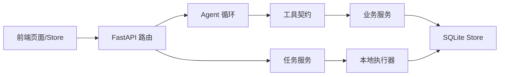

# 代码高内聚低耦合改善调研方案 / 2026-10-16 / 状态：评审

> 目标：用短周期、可验证的方式改善平台核心代码边界，为后续插件模块和二次开发建立稳定基础。
> 执行对象：Claude Code。本文先做调研和小范围验证，不要求一次性重构全部代码。

## 1. 预期结果

调研结束时必须回答：

1. 哪些模块属于平台核心、SR 业务和可选业务功能。
2. 哪些模块仍依赖内部实现、全局状态或导入副作用。
3. 哪三个低风险改动可以短期显著降低耦合。
4. 插件接入最小需要哪些后端、前端、配置和版本接口。
5. 哪些问题应等第二个真实插件出现后再抽象。

交付物：依赖地图、问题清单、优先级排序、三项短期改进的实施设计、验证结果和插件扩展边界草案。

## 2. 调研范围

优先检查：

```text
backend/api/app.py              应用工厂、生命周期、运行时状态
backend/api/platform.py         工具、聊天、队列、掩码 API
backend/agent/loop.py           Agent 状态机与工具调用
backend/tools/contract.py       工具契约与注册表
backend/tools/*.py              Agent 工具包装层
backend/services/*.py           业务服务与执行器
backend/services/store.py       SQLite 持久化
backend/pathguard.py            路径与安全边界
frontend/src/router/index.ts    前端路由
frontend/src/App.vue            导航和全局外壳
frontend/src/components/       查看器侧栏与上下文组件
frontend/src/stores/            前端状态与 API 调用
```

SR 生产脚本、`vendor/`、外部导入目录和构建产物只检查调用边界，不纳入第一轮重构。

## 3. 调研步骤

### 3.1 模块职责表

为每个核心模块填写：

| 模块 | 唯一职责 | 输入/输出 | 直接依赖 | 被谁调用 | 全局状态 | 可独立测试 | 插件是否应依赖 |
|---|---|---|---|---|---|---|---|

判定规则：

- 同时负责协议解析、业务决策、文件写入和 UI 投影，标记为职责过宽。
- 依赖另一个模块的私有变量、内部字典或导入副作用，标记为强耦合。
- 通过环境变量、模块级注册表、单例 Store 获取行为，标记为隐式依赖。
- 只因 SR 业务存在的字段，不直接纳入通用平台接口。

### 3.2 依赖地图

至少绘制两张 Mermaid 图。第一张表示运行时方向，第二张表示反向依赖、注册副作用、共享状态和测试替身注入点。每条边都必须能在源码中找到证据。



### 3.3 统计耦合证据

```bash
rg -n "from backend|import backend|from \\.|import .*services|app\.state|os\.environ|_REGISTRY|default_store|list_tools" backend frontend/src
rg -n "\\.run\\(|\\.status\\(|\\.cancel\\(|\\.get\\(|\\.put\\(" backend/api backend/agent backend/tools
```

记录跨层导入、API 直接访问内部数据、前端直接拼接协议、模块级可变状态、测试替身和重复业务规则。数量只作为线索，每个高值必须关联具体维护风险或测试困难。

## 4. 优先选择的三项改进

调研后从下列候选中选三项，优先不改变外部 API。

### A. 统一应用上下文与显式依赖

定义轻量 `AppContext` 或等价结构，提供 Store、配置、日志和运行时目录。路由通过请求上下文取得服务；服务函数优先接收显式依赖；保留兼容包装函数供旧测试迁移。不把所有服务塞进一个大上下文类。

验收：测试可以使用临时 Store 和工作目录，不修改全局环境即可隔离案例。

### B. 统一工具注册与调用边界

将工具注册表封装为实例；增加工具 ID、版本、权限范围、超时和可见性元数据。所有调用统一经过参数校验、异常转换、日志和结果封装。保留 `@tool` 兼容适配层。注册冲突、Schema 错误和加载错误必须显式报告。

验收：Agent 与 `/api/tools/{name}` 使用同一执行路径；插件工具不需要修改 Agent 循环。

### C. 抽取稳定业务上下文接口

首批只提供只读快照：当前场景、影像元信息、当前 ROI、原图像素坐标、路径校验与结果登记。定义版本化 JSON；插件不读取 Pinia 私有字段；明确预览坐标、原图坐标和地理坐标转换；写入必须经过宿主服务。

验收：示范插件不导入 `viewer.ts` 即可读取当前上下文。

### D. 分离 SR 专属任务与通用任务

先整理创建、排队、运行、成功、失败、取消、未知等生命周期接口。保留 SR 专属字段在 SR 服务内部，不立即迁移数据库。只有第二个真实长任务出现时才抽取通用任务适配器。

验收：插件可选择短任务直接返回；长任务不必伪装成 SR 任务。

### E. 明确前端扩展槽

首批开放独立页面、查看器侧栏页签、当前影像操作按钮和场景行操作。先定义最小 props 与事件；保留内置页面；不开放 canvas 内部对象、Pinia 私有状态或 DOM 查询作为插件 API。

验收：新增页面型示范插件时，核心路由和 `App.vue` 不需要逐处修改。

## 5. 插件可行性验证

不先做插件市场、热安装、远程 JavaScript 或沙箱。先实现一个随源码部署的可信示范插件：`image_quality`。

要求：后端注册 JSON Schema 工具；前端提供上下文侧栏页签；读取当前影像和 ROI 快照；返回指标或报告；默认不修改原始影像；禁用插件后核心页面、Agent、队列和场景库正常。

插件清单至少包含：`id`、`name`、`version`、`host_api_version`、后端入口、前端入口、启用状态。

明确边界：Python 插件与服务端同权限运行；路径写入经过宿主校验；插件异常不能拖垮主应用。

## 6. 优先级与停止条件

### P0：证据和边界

- 模块职责表；
- 两张依赖图；
- 跨层依赖与全局状态统计；
- 选定三项短期改进；
- 明确不纳入本轮的范围。

### P1：短期实现

- 工具统一调用边界；
- 应用上下文或显式依赖；
- 稳定场景与选区快照；
- 一个示范插件。

### P2：第二个插件驱动的抽象

- 通用长任务适配器；
- 更细粒度权限；
- 插件配置 UI；
- 插件包发布和兼容性测试。

停止条件：如果第一项示范插件仍需修改五个以上核心文件，停止增加功能，重新收缩宿主接口。

## 7. 验证清单

- [ ] 后端测试全部通过。
- [ ] 前端类型检查和测试全部通过。
- [ ] Agent 工具、REST 工具和插件工具结果结构一致。
- [ ] 禁用示范插件后核心功能回归通过。
- [ ] 同名工具启动失败且错误可读。
- [ ] 插件缺依赖或入口异常时，核心应用仍能启动或明确拒绝启动。
- [ ] 插件不能绕过路径校验写入任意目录。
- [ ] API 和前端扩展契约有版本字段或兼容策略。
- [ ] 测试不依赖真实盘阵、GPU、LLM 或外部网络。
- [ ] 真机只验证权限、路径、GPU 和长任务。

## 8. 需要用户确认的产品决策

开始 P1 前确认；未回答时按括号默认值执行：

1. 插件是否只面向可信源码开发者？（默认：是）
2. 插件是否允许修改原始影像？（默认：否）
3. 是否需要在线安装/卸载？（默认：否，安装后重启）
4. 首个示范插件是否采用“影像质量检查”？（默认：是）
5. 插件是否必须由 Agent 调用？（默认：页面和 Agent 都支持，但权限分别控制）

## 9. 交付格式

```text
范围：P0 / P1 / P2 + 条目
发现：事实、文件和行号
决定：保留 / 抽取 / 延后
修改：文件列表与接口变化
验证：命令、通过项、失败项
风险：未验证内容与下一步
```

不得仅报告“重构完成”；必须给出依赖证据、外部行为是否变化和测试结果。
