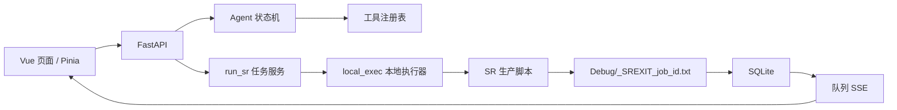

# 调试背景与已验证结论 / 2026-10-16 / 状态：维护

> 用途：后续调试、部署和代码审查的共同背景。新会话先读本文，再读 `docs/status/current-question.md` 与 `docs/status/sr-local-execution.md`。
> 本文记录已经确认的原因、决策和边界；新的事实追加到对应章节，并注明验证方式。

## 1. 平台当前形态

- 前端：Vue 3 + TypeScript + Vite + Pinia。
- 后端：Python FastAPI，由 Uvicorn 运行；数据使用 SQLite；长连接状态使用 SSE。
- Agent：自研串行状态机，调用 OpenAI 兼容接口；工具通过 `backend/tools/contract.py` 注册。
- SR：后台在本机直接启动 SR 生产解释器和 bash 运行脚本；结果由契约校验器写入判定文件，再同步到 SQLite 和队列 SSE。
- 当前部署不依赖 Slurm、集群调度器或共享盘。

## 2. Slurm 调整结论

项目评估确认：当前 SR 需求是单机、单卡、单槽执行，Slurm 与本地执行链功能重叠，增加了配置、部署和状态处理复杂度。因此执行路线收口为本机执行。

已经完成的收口方向：

- 删除 Slurm 客户端、假调度器和调度器状态分支；
- 生成普通本机运行脚本，不含 `#SBATCH`；
- 保留 SR 输入准备、契约校验、备份恢复和结果归位；
- `SR_EXECUTOR` 只接受 `local`；工作目录使用 `SR_WORK_DIR`，兼容读取旧工作目录变量；
- Agent 状态工具通过任务服务定位任务和判定文件，不再直接查询调度器；
- 生产脚本变体改为平台适配命名，生产基线脚本保持独立。

后续排查时不要把 Slurm 配置、`sbatch`、`squeue` 或 `sacct` 当作当前运行链路。文档中的历史兼容名称只用于迁移识别。

## 3. 本地执行可靠性结论

本地执行器必须同时满足以下约束：

- 一个执行槽，同一时刻只运行一个 SR 子进程；
- 任务编号、配置、脚本、日志和运行记录持久化；
- 终态以业务判定文件为准，进程退出码 0 不能单独代表成功；
- API 重启后根据运行记录、进程身份和判定文件判断状态；
- 无法确认是否启动过的运行显示 `UNKNOWN`，不得自动重投；
- 取消必须停止完整进程树；
- 输入准备已经替换本体时，取消后必须尝试用备份恢复本体。

与这些约束相关的实现位置：

- `backend/services/run_sr.py`：参数归一化、指纹、幂等、运行脚本、取消入口；
- `backend/services/local_exec.py`：跨进程执行锁、子进程、运行记录、状态和取消；
- `backend/services/sr_result.py`：判定文件解析和终态映射；
- `SR_code/variants/verify_sr_run.py`：业务契约检查、结果归位和正常失败恢复。

已补的可靠性保护：

1. 数据库提交互斥锁保护“查任务 → 写意图 → 启动运行”的全过程，避免同参数并发启动两次。
2. 执行槽使用稳定的内核文件互斥，避免空锁文件和过期锁清理竞态。
3. 取消后等待进程组结束，必要时强制终止；未确认停止不报告成功。
4. 运行记录保存 `body`、`backup` 和 `mask_1x` 路径，取消后尝试恢复本体。

## 4. 已验证的测试结果

最近一次后端完整回归：

- `python -m unittest discover -s backend/tests -q`
- 765 项通过，9 项跳过。

相关本地执行测试：

- 112 项通过。
- 覆盖运行编号、单槽、重启状态、结果判定、排队取消、运行取消和未知状态释放。

前端：

- TypeScript 类型检查通过；
- 17 个测试文件、447 项测试通过。

生产变体：

- `python SR_code/tools/gen_platform_variant.py --check` 通过。

这些结果是开发机和测试替身验证，不等同于真实 GPU、真实盘阵权限和生产解释器验收。

## 5. CentOS 7 / llama.cpp 结论

CentOS 7 上的大模型服务已经部署成功。故障定位结果如下：

- UD 权重文件不是根因；
- UD 和非 UD 权重都可以使用；
- `llama.cpp` 的 master 版本存在兼容问题；
- 回退到已验证的 release 版本后，UD 和非 UD 均可正常运行。

部署规则：

- 固定已验证的 `llama.cpp` release 版本，不直接跟随 master；
- 记录 commit/tag、编译参数、CUDA/驱动版本和启动参数；
- 回归测试至少包含一份 UD 权重和一份非 UD 权重；
- 更换 `llama.cpp` 版本时，先做模型加载、短对话、工具调用和长请求验证，再更新生产基线。

## 6. 插件化结论

平台具备插件扩展基础，但当前最适合先做可信源码插件，而不是热插拔或插件市场：

- 后端工具已有 JSON Schema 和统一返回结构；
- Agent、REST 工具入口都能复用工具注册机制；
- FastAPI 应用工厂适合挂载插件路由和生命周期；
- 前端仍有固定路由、导航和查看器侧栏，需要先抽取扩展槽；
- SR 任务表和执行器仍是 SR 专属，不应直接作为所有插件的通用任务模型；
- Python 插件与服务端同权限运行，必须明确只支持管理员安装的可信插件。

插件工作顺序：先改善高内聚低耦合边界，再统一工具调用、应用上下文和只读场景/ROI 快照，最后用一个影像质量检查插件验证边界。详细方案见 `docs/planning/code_cohesion_decoupling_research_plan.md`。

## 7. 后续调试规则

遇到问题时先判断属于哪一层：

1. 模型加载或推理失败：先核对 `llama.cpp` release 版本、构建参数和 UD/非 UD 权重；
2. Agent 不调用工具：检查工具注册表、工具 Schema、OpenAI 兼容接口和模型工具调用能力；
3. SR 状态异常：先查 SQLite 任务行、`runs/<job_id>.json` 和 `Debug/_SREXIT_<job_id>.txt`，再查日志；
4. 任务重复或并发写场景：检查提交锁、执行槽锁和运行记录，不先改前端轮询；
5. 取消后影像异常：检查备份是否存在、运行记录中的恢复路径和校验器是否已经执行；
6. 真机失败：区分开发机测试通过与真机权限、路径、GPU、解释器依赖未验证。

调试结论必须记录：现象、复现条件、根因证据、修改位置、验证命令和仍未验证的环境因素。

## 8. Qwen/llama.cpp OpenAI 兼容输出

开发机不需要安装 CentOS 7 的推理环境即可兼容其响应格式。`backend/agent/loop.py::parse_response` 读取标准 `content`、`tool_calls`，并识别 Qwen/llama.cpp 的 `reasoning_content` 与 `finish_reason`。

- `reasoning_content` 作为元数据保留，不回传给模型，也不直接展示为最终回答；
- `content` 为空且 `finish_reason=length` 时，Agent 返回明确错误，提示生成上限耗尽；
- 开发或部署配置使用 `SR_LLM_BASE_URL=http://127.0.0.1:8080/v1`，不要把 `0.0.0.0` 当作客户端地址；
- 初次联调建议 `SR_LLM_MAX_TOKENS=256` 或更高，并同时验证普通回答、工具调用和思考模式；
- 模型接口返回的 `model` 可能是实际 GGUF 路径，平台以请求配置的模型名发起调用，不依赖响应中的模型字段。
