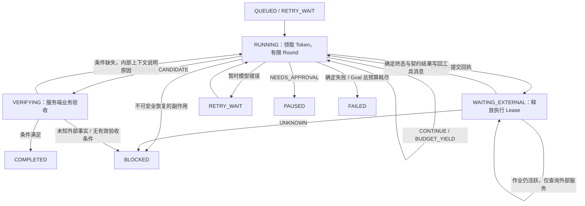

# Durable Goal Runtime：执行语义与验收

> 日期：2026-10-24 · 状态：已定（真实模型、内网 SR 与 GPU 验收待核）

## 1. 源码审计基线

审计入口为 `main`，工作树起始无未提交文件；事实来源为本地源码。以下是本任务要求保留的审计结论。

| 检查项 | 审计基线结论 |
|---|---|
| RUNNING 调度 | `goal_tick` 直接调用同步 `run_round`；`claim_goal` 没有接入执行路径；结果由独立的 `transition_goal` 保存 |
| Loop 恢复与预算 | 恢复历史后无条件追加 user，包括空 Prompt；修复消息没有单独持久化；工具结果逐条保存；达到 `max_turns` 记 Session error |
| Tool Intent 覆盖 | SR 服务在物理提交前登记 Intent；普通工具执行入口没有通用 Goal Intent，`fix_bad_lines` 的文件写入缺少此保护 |
| SR 提交结果与关联 | 服务返回 `job_id/status/config_xml/batch_script/log_dir/idempotent`；默认 Intent 属于 `sr:<fingerprint>`；Loop 没有可靠的 Goal/Step 关联 |
| 外部终态续跑 | 等待期查询统一 SR 服务；成功终态直接进入 VERIFYING，没有把真实结果回灌会话并恢复模型 |
| Verifier | VERIFYING 只检查 Checkpoint 的 `verified/verified_by`，没有实际执行业务验收 |
| 事务与所有权 | 状态与 Goal Event 同事务，Version 可选；领取只有 owner/until，没有 Token；共享连接允许跨线程，但事务可能互相干扰 |
| 测试覆盖 | 聊天恢复、SR 指纹、提交中断已有测试；缺少 Goal 跨 Round、重启、Lease 失效和完整业务验收测试 |

基线命令为 `python -m unittest backend.tests.test_agent_loop backend.tests.test_store backend.tests.test_run_sr -q`：172 项，170 项通过，2 项 UNKNOWN 自动重投的断言与安全要求冲突。当前断言要求 UNKNOWN 阻断且物理提交次数不增加。

机制参考：[Pi Durable README](https://github.com/earendil-works/pi/blob/main/packages/durable/README.md) 的独立执行生命周期与持久化恢复；[tool.ts](https://github.com/earendil-works/pi/blob/main/packages/durable/src/harness/tool.ts) 的执行前意图、重放策略和结构化控制结果。本实现使用项目已有 Python、FastAPI、SQLite、ToolRegistry 和 Loop。

## 2. 文件与职责

| 文件 | 实际职责及原因 |
|---|---|
| `backend/agent/round_outcome.py` | 八种 Round Outcome；调度控制独立于模型自然语言 |
| `backend/agent/loop.py` | 无新 Prompt 续跑、恢复消息持久化、有限预算、安全工具结果 Hook；普通聊天保留原接口 |
| `backend/services/goal_worker.py` | 既有 Runtime 的执行适配、意图恢复、SR 对账、业务验收、单线程有界执行与续租 |
| `backend/services/goal_runtime.py` | Goal REST/SSE；接入 Worker；创建验收条件校验；用户状态操作使用 Version |
| `backend/services/goal_lease.py` | 当前 Worker 的 Token/Version/停止信号；工具和 Store 共用同一所有权上下文 |
| `backend/services/store.py` | 复用既有表；迁移补充 `lease_token`；领取、续租、事务保护、每线程连接与统一关闭 |
| `backend/services/run_sr.py` | 提交预留的事务竞争检查；Job ID、Intent 与 Step 关联；外部事实未知的专用异常 |
| `backend/tools/run_sr.py` | 使用当前执行上下文的 Store；返回结构化不确定错误 |
| `backend/tools/contract.py` | 真正调用注册工具前复查 Lease；所有权异常保持可识别 |
| `backend/api/app.py` | lifespan 退出时统一关闭 Store 连接 |
| `backend/tests/test_goal_runtime.py` | Mock LLM / Fake SR 的持久化闭环、故障注入、并发及 API 集成 |
| `backend/tests/test_run_sr.py` | 固定 UNKNOWN 不重投的现行契约 |
| `.gitignore` | 本地 `.venv/` 不入库 |

## 3. Goal 与 Round 状态



用户暂停、取消会使正在运行的 Worker 所有权失效；暂停后的恢复从 QUEUED 重新领取。SR 的失败、合法跳过、缺产物都如实回灌，后续模型可以按真实结果推进；UNKNOWN 直接安全阻断。

## 4. Loop 继续执行与预算

- 新会话必须提供 Prompt；普通聊天使用既有参数。
- `resume=True` 加真实 Prompt：恢复历史、修复未闭合工具声明、追加一次真实 user 消息。
- `resume=True, prompt=None`：只恢复并继续，持久化修复结果，不插入空 user。
- Goal 首次输入与 `input_admitted` 在同一事务保存；附加到已有聊天时只接纳一次 Goal 输入。Goal 与聊天共用会话锁。
- 已有工具回执按 session、assistant 序号、tool call id 精确恢复；无回执的未知副作用不自动重放。尚未执行的批量工具声明明确标为未执行。
- `durable=True` 达到 Turn、模型调用、工具调用或运行时间限制，返回成功让出的 `BUDGET_YIELD`，Session 保持 active。
- 普通聊天保留既有 `max_turns` 错误返回约定；后台 Goal 使用 durable 预算切片。
- 实际模型请求 timeout 不超过 Round 时间配置；durable 模式关闭 SDK 隐式重试，重试交由 Goal 调度计量。

默认配置：

| 环境变量 | 默认值 | 含义 |
|---|---:|---|
| `SR_GOAL_ROUND_TURNS` | 4 | 单 Round Turn 上限 |
| `SR_GOAL_ROUND_MODEL_CALLS` | 4 | 单 Round 模型调用上限 |
| `SR_GOAL_ROUND_TOOL_CALLS` | 16 | 单 Round 工具调用上限 |
| `SR_GOAL_ROUND_SECONDS` | 60 | 单 Round 运行时间上限，工具边界安全让出 |
| `SR_GOAL_LEASE_SEC` | 60 | 领取有效期；约每 1/3 有效期续租 |
| `SR_GOAL_POLL_SEC` | 5 | 调度与外部查询间隔 |

Goal 的 `max_rounds/max_model_calls` 是累计总预算。Round 启动和模型调用在实际执行前预记账，崩溃不会抹掉已消耗的调用额度。Checkpoint 保存 Round 结构化结果与累计工具次数、时间和可获得的 token 用量；崩溃前服务商未返回的 token 数无法精确得知，不伪造数值。任意同步工具的中途强杀不属于安全切片，时间边界在工具执行前后检查。

## 5. SR 工具结果与自动续跑

链路为：assistant 工具声明 → Goal Step / Tool Intent → SR 指纹预留 → 物理提交 → Job ID / Intent / Step 关联 → 真实工具消息 → WAITING_EXTERNAL。

SR 服务的提交预留在 `BEGIN IMMEDIATE` 中再次检查指纹，竞争者不能同时物理提交。Job ID 和 Intent 回执在同一事务提交。`run_sr` 返回成功 Job ID 后，Loop 立即让出；同一批剩余声明以“未执行”闭合，后续模型重新决策。

WAITING_EXTERNAL 仅调用统一 `query_job_status`。确定终态时，服务端重新运行部署的 `verify_sr_run.py::check_contract`，检查真实配置、退出码、SRLOG 和产物；结果作为内部 `sr_job_status` 工具回合写入会话。消息、Intent/Step 终态、Checkpoint 和外部终态事件在同一事务保存，然后恢复 RUNNING。

物理提交后未记下 Job ID：保留无回执任务与 EXECUTING/UNKNOWN Intent，恢复时 BLOCKED，禁止重投。已有回执但工具消息未保存：恢复真实回执，进入等待；不调用提交器。已完成的只读回执同样恢复，不重复执行。

## 6. Lease、Version 与事务

每次成功领取都持久化唯一 Token；续租保持 Token 和 Version。重新领取产生新 Token。领取、续租、释放使用 SQLite 事务。

Worker 写事务同时核对 Token、Lease 尚未过期、预期 Version，提交前再次核对有效期；没有新 Worker 接管也不允许过期 Worker 写入。状态迁移递增 Version，当前 Worker 同步更新自己的预期 Version；事务回滚也恢复本地 Version。

保护范围包括 Checkpoint、Goal Step、Round 结果、Goal Event、累计预算、外部关联，以及 Worker 写入的消息、trajectory 和 SR 账本。既有 Store 方法内部的 commit 服从外围事务，状态与事件不会部分提交。

模型返回后、工具入口及真正发出 SR 请求前复查所有权。工具执行途中失去所有权时拒绝后续写入；已提交的外部请求无法撤销，恢复依赖持久化 Intent 和外部事实，不盲目重投。

Store 每线程使用独立连接，应用退出统一关闭所有连接；Worker 完成只关闭自身线程连接。后台执行器固定单线程，SSE 订阅不持有任务生命周期。停止 Worker 先设置停止信号并撤销领取，迟到模型响应无法再产生工具副作用。

## 7. 独立业务验收

创建 Goal 的初始 Checkpoint 只接纳 `acceptance`，忽略客户端提供的 `verified`、`verified_by`、伪造外部结果和执行进度。普通状态迁移不能进入 COMPLETED；只有服务端运行 Verifier 后走专用完成接口。

实际可提交的创建请求示例：

```json
{
  "title": "查询指定场景，完成 SR，并生成报告",
  "max_rounds": 20,
  "max_model_calls": 100,
  "checkpoint": {
    "acceptance": {
      "min_sr_jobs": 1,
      "sr_scenes": ["/DiskArray/explicit_scene"],
      "required_tools": ["search_scenes", "run_sr"],
      "artifacts": ["/DiskArray/explicit_scene/report.txt"],
      "allow_skip": false
    }
  }
}
```

验收独立读取 Intent、Step 对应的工具执行事实、SR 状态、实时 SR 契约，以及明确指定的非空产物文件。`sr_scenes` 要求指定输入场景的作业通过；合法跳过只在显式 `allow_skip=true` 时计入成功数量。非法或空验收条件不能使空任务完成。无验收条件的 Goal 可以执行，完成候选进入 BLOCKED。

验收未通过且事实确定：真实失败原因写为 system 内部上下文，恢复 Agent，直到满足条件或耗尽 Goal 总预算。未知副作用进入 BLOCKED。当前通用验收支持工具成功事实、SR 数量/场景、非空文件存在性；遥感质量、报告内容正确性等更强业务条件需要领域 Verifier，不能从文件存在性推断。

## 8. 自动化验收与运行命令

使用项目内虚拟环境。Windows PATH 必须优先指向真实 Git Bash；本机 WindowsApps 的 `bash.exe` 不能用于这些脚本测试。

```powershell
$env:PYTHONUTF8='1'
$env:PATH='D:\Git\usr\bin;D:\Git\bin;'+$env:PATH
& '.\.venv\Scripts\python.exe' -m unittest discover -s backend/tests -t . -q
& '.\.venv\Scripts\python.exe' -m unittest backend.tests.test_goal_runtime -q
& '.\.venv\Scripts\python.exe' -m compileall -q backend
git diff --check
```

完整 Mock/Fake 三步骤使用真实 Loop、SQLite、SR 提交服务和文件契约校验器，检查数据库、事件、工具次数和物理提交次数。两作业用例验证两次外部唤醒及一次最终验收。

故障覆盖包括：恢复不插入空 user、聊天追加兼容、Round 切片、总预算耗尽、提交立即等待、等待期零模型调用、终态回灌、验收失败续跑、伪造验证标记、服务重启、提交回执丢失、回执/消息间崩溃、只读回执恢复、UNKNOWN 不重投、旧 Token 拒写、无接管也拒写、事务回滚、竞争领取、LLM 返回后失权、执行中失权、续租、SSE 断线、关闭时迟到响应、单 Goal 故障隔离、现有项目 Mock 经真实 API 和注册工具的低风险集成。

最终实测结果见文末验收数据；测试输出中的 `injected single goal fault` 为故障注入预期日志。

## 9. 真实环境与剩余 P0

开发环境没有配置真实 `SR_LLM_BASE_URL` 和 SR 执行器。项目自带模型 Mock 经 API 的检索 Goal 已实测；它不等于真实模型验收。Fake SR 产物不是遥感算法实测产物。

以下项目待内网实测：真实模型长任务与超时行为、生产 conda/GPU 的 SR 产物、真实进程强制退出及跨进程接管、盘阵权限与实际大图契约、服务重启后的真实外部执行器对账。启动真实 Goal 时需提供明确业务验收条件，部署目录需有可加载的 `SR_VERIFY_SCRIPT`。

剩余 P0 为真实环境验收、按具体业务补充领域 Verifier，以及 UNKNOWN 作业的人工/执行器对账后安全恢复流程。当前 UNKNOWN 安全停止，不提供自动重新提交。后台会话锁在单进程内生效；多 API 进程共用聊天会话需要独立的持久化会话互斥，不能把 Goal Lease 当作聊天锁。

## 10. 实测验收数据

- 全量后端：`python -m unittest discover -s backend/tests -t . -q`，839 项，5 项平台条件跳过，其余通过；实测 44.701 秒。
- Goal 专项：`python -m unittest backend.tests.test_goal_runtime -q`，28 项；被全量执行覆盖。
- 聊天、SR 队列、Store、SR 提交与工具注册集中回归：315 项，1 项平台条件跳过，其余通过（该命令执行时 Goal 专项为 22 项；最终新增用例已纳入全量 839 项）。
- 本机 Bash 环境校准：`python -m unittest backend.tests.test_local_exec backend.tests.test_local_chain -q`，22 项通过。
- `python -m compileall -q backend` 与 `git diff --check` 通过。
- 三步骤与两作业测试检查：物理提交分别为 1 次与 2 次；首次 SR 完成不触发整体验收，只有最终候选通过服务端验收产生一次 `goal_verified`。
- 不包含真实模型、真实遥感算法或 GPU 验收结论。
