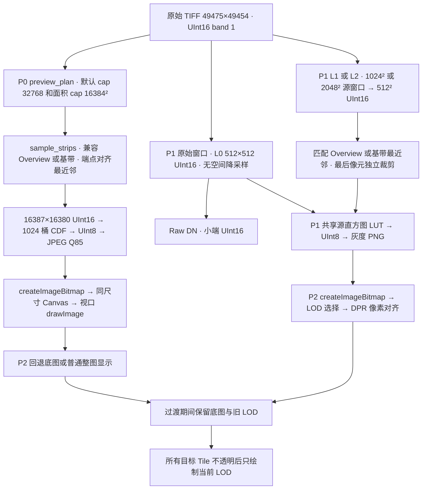
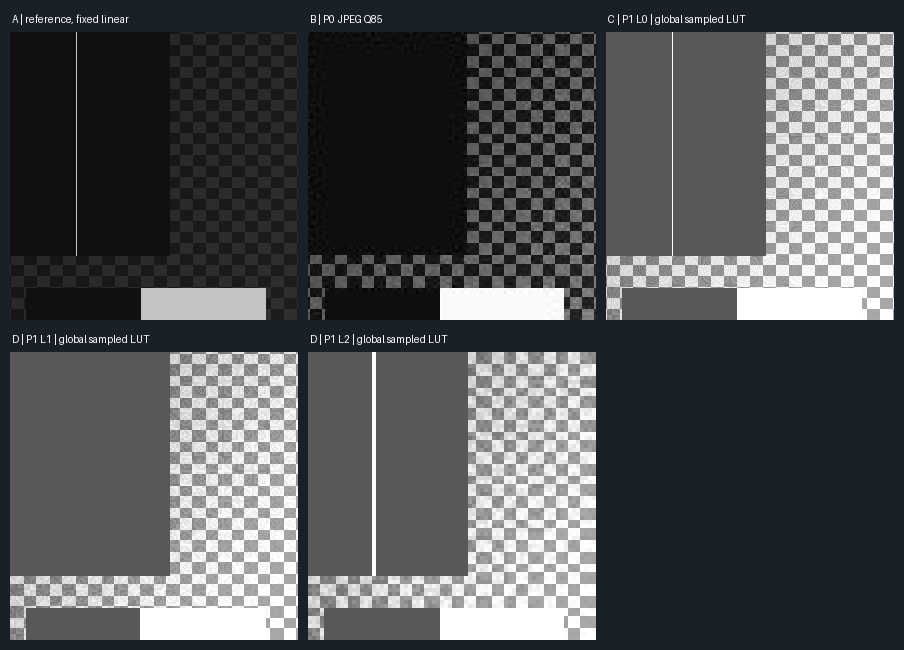
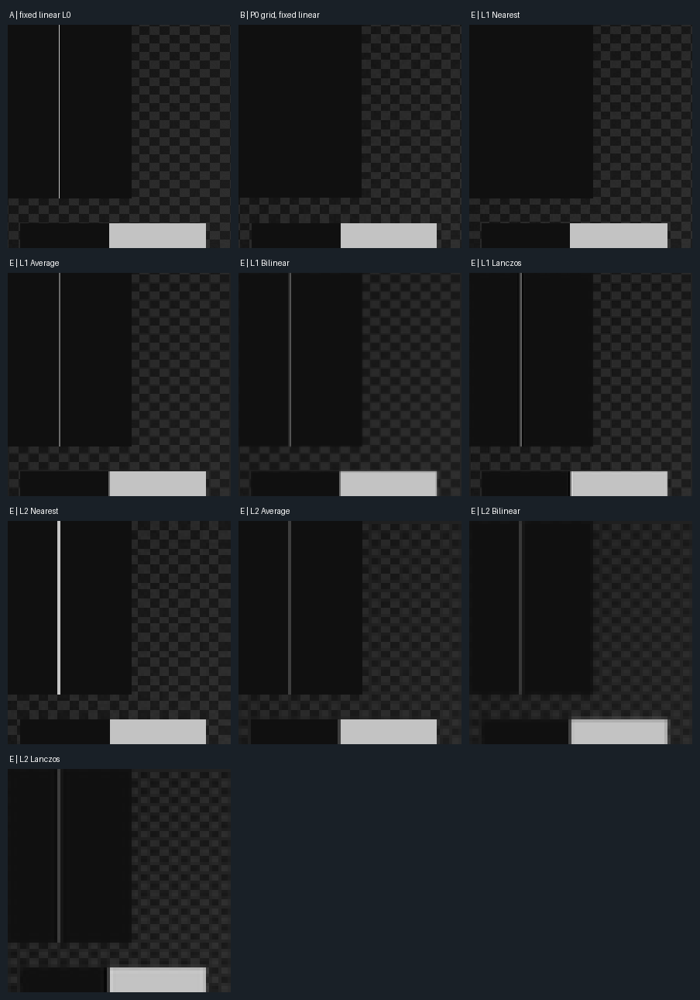
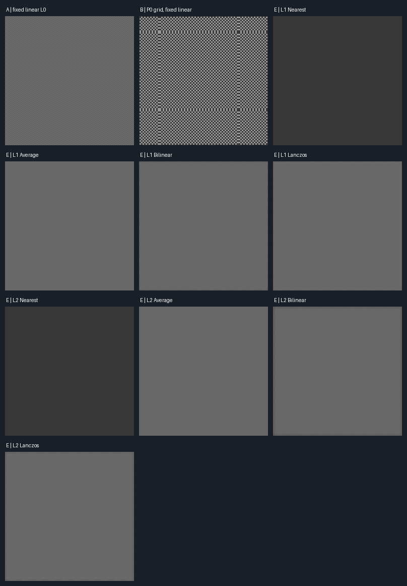
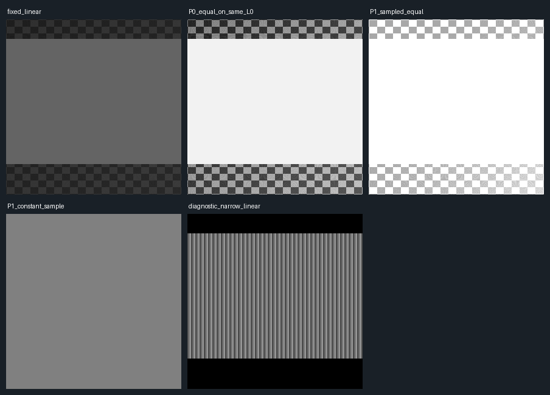

# P0/P1/P2 图像重采样与画质损失审计

2026-11-25 · 本地 `main` 为 `36e975de0b810d9dc732a6357494ea811db19399`，已获取的 `origin/main` 为 `dc3c152a108b51bb4a6b8cc13334bd7f79da6d2f`。本地多出的提交包括实际分辨率标签及已绘制 LOD 跟踪。审计使用当时的工作树，原有未提交修改保留。生产代码未因本审计改动。

## 结论

**整景 JPEG 和 L1/L2 的首要风险是空间取样。原生 L0 完成覆盖后，显示细节的主要可修复风险转为 UInt16 灰度映射。** JPEG 编码和 Canvas 插值都能改变灰度和边缘形状，不能恢复已被取样遗漏的细线。当前优先级是保留原生 Tile 的自定义显示能力、修复采样统计退化，再为粗层和整图预览比较抗混叠重采样。真实 PAN 的光学 MTF、源端已有锐化或模糊、生产 Overview 的生成核均未取得证据。

## 1. 处理链路



| 路径与阶段 | 函数及代码位置 | 输入 → 输出、算法与不可逆损失 |
|---|---|---|
| P0 尺寸 | [`preview_target_edge` / `preview_plan`](../../backend/services/preview_jpg.py#L369) | 默认长边 32768、面积 (16384^2)。请求 1:1 与 1/2 均为 **16387×16380**，两轴约 0.331217，实际约 **1/3.02**。1/4 为 **12369×12364**，1/16 为 **3092×3091**。计划本身只决定网格。 |
| P0 Overview | [`_overview_preview`](../../backend/services/preview_jpg.py#L677) | 扫描带 reduced-image 标记、非掩码、无压缩条带、尺寸至少覆盖目标且比例和关键标签匹配的 IFD，优先最小可用层。若存在可接受的约 1/2 Overview，先继承其 DN，再取样到实际约 1/3.02。Overview 生成核不会由该函数重新确定。 |
| P0 主读取 | [`sample_strips`](../../backend/services/preview_jpg.py#L497) · [`build_preview_pixels`](../../backend/services/preview_jpg.py#L728) | Band 1，横纵均取 `round(i*(sourceSize-1)/(outputSize-1))`，从基带或 Overview 取 UInt16。没有低通滤波，样本遗漏和混叠不可逆。 |
| P0 小图兜底 | [`_pillow_preview`](../../backend/services/preview_jpg.py#L659) | 当快速条带链不支持布局且不足 67,108,864 px 时，Pillow 先 `convert("L")` 到 8-bit，再 Lanczos（`reducing_gap=2.0`，可能含预缩减）。此分支先降低灰度位深。49K 级大图超过兜底预算。 |
| P0 灰度、编码、缓存 | [`stretch_equal`](../../backend/services/preview_jpg.py#L600) · [`write_preview_jpg`](../../backend/services/preview_jpg.py#L1028) · [`ImageOpen._preview`](../../backend/services/image_open.py#L339) | 主路线先取样再按**已取样整图**统计。1024 个桶构建 CDF，再查表和量化成 UInt8，WhiteIsZero 取反。灰度 JPEG Q85 是第二项独立的有损操作。缓存按源修订、有效网格、波段、规则及质量寻址。 |
| P0 解码和显示 | [`decodeJpegBitmap`](../../frontend/src/lib/jpegBitmap.ts#L46) · [`decodeJpgToCanvas`](../../frontend/src/stores/viewer.ts#L240) · [`sceneDecodeCanvas`](../../frontend/src/lib/scene.ts#L495) · [`paintStretch`](../../frontend/src/stores/viewer.ts#L3578) | 合规已交付 JPEG 不触发解码 resize。旧大图可按 SOF 尺寸请求高质量 resize。Bitmap 同尺寸绘制到 Canvas，读取 R 通道到 Float32 仍是 8-bit 显示强度。普通场景 JPEG 默认可再做一次均衡，P2 默认 equal 底图跳过这次重绘。普通 JPEG 的交互副本还可能预缩到 4096 长边，再由 Canvas 绘制。 |
| P1 原始窗口 | [`SparseStrips.read`](../../backend/services/raster_window.py#L105) · [`RasterWindowReader.read_window`](../../backend/services/raster_window.py#L194) · [Raw 响应](../../backend/services/image_tiles.py#L215) | 合规无压缩单波段 BlackIsZero 条带走直接读。其他受支持 TIFF 调只读 GDAL band。L0 512×512 → 512×512，强制 nearest 等尺寸，跳过 Overview。Raw 响应保留 UInt16 和 NoData 元数据。 |
| P1 LOD | [`tile_window`](../../backend/services/image_tiles.py#L28) · [`sections` / `ReadAsArray`](../../backend/services/raster_window.py#L216) | 固定 `2^L` 源像元格。L1/L2 内部块分别 1024²/2048² → 512²，基带条带取格中心 `floor((2*i+1)*span/(2*out))`。匹配二次幂且宽高为向上取整的 Overview 时，先读该层，再按剩余倍率最近邻。奇数边缘单独处理不足步长的末格。整个源的 L1/L2 逻辑尺寸分别 **24738×24727**、**12369×12364**。泛窗口另允许 GDAL Average/Bilinear。Tile 路由固定 nearest，Lanczos 只用于本次控制实验。 |
| P1 灰度与 PNG | [`_source_stats`](../../backend/services/image_tiles.py#L136) · [`display_pixels`](../../backend/services/image_tiles.py#L59) · [`_tile`](../../backend/services/image_tiles.py#L172) | 所有 LOD 先从对应空间网格取原始 DN，再应用同源同波段的全局 LUT。统计最多 25 个 32² L0 采样窗，排除非有限值/NoData。NoData 映射黑色，仍为不透明 PNG。UInt16 DN、8-bit 灰度和浏览器 RGBA 的 512² 缓冲分别为 **512、256、1024 KiB**。PNG 保留已量化灰度。缓存身份含 raster revision（包括受支持的侧车修订）、波段、LOD/xy、采样及拉伸规则版本。 |
| P2 进入条件 | [`openTileSource` / `overviewDiv`](../../frontend/src/lib/tileSource.ts#L21) · [`readAssetOverview`](../../frontend/src/stores/viewer.ts#L2589) · [`applySceneJpgToRec`](../../frontend/src/stores/viewer.ts#L2846) | 服务器有效单波段资产、相同源版本和尺寸、512 格网。49K 标准 Strip 的 P2 JPEG 底图长边目标 3200，至少降到 1/16。若大压缩图的 P0 生成失败，可退全幅粗 PNG。仅本地文件且服务端没有资产时沿用 Worker 预览。 |
| P2 选层、渲染和回退 | [`tileRequests`](../../frontend/src/lib/tileScheduler.ts#L31) · [`rasterTransform` / `tileLevel`](../../frontend/src/lib/viewMath.ts#L33) · [`TileRenderer.draw`](../../frontend/src/lib/tileRenderer.ts#L117) · [`TifCanvas.render`](../../frontend/src/components/TifCanvas.vue#L244) | 以源像素到背板像素倍率选 LOD，带滞回和可见块预算。PNG 由 `createImageBitmap` 原尺寸解码。对共同边界按 DPR 取整，Tile 缩小时开启 Canvas 平滑，等大和放大时关闭。可见目标块全部不透明后省略回退。DPR 背板最大 2，设备 DPR 更高可能额外合成缩放。 |
| P2 模式切换 | [`tilePane`](../../frontend/src/components/TifCanvas.vue#L236) · [`zoomNative`](../../frontend/src/stores/viewer.ts#L3989) · [实际渲染标签](../../frontend/src/components/TifCanvas.vue#L314) | 自定义拉伸、非 equal 模式、预览拉伸层、纯差异热图会排除 Tile，显示来自整图概览。差异叠加可继续盖在 Tile 之上。原生倍率达到目标 L0 只是第一个条件，当前视口需 `readyLOD=0`；高密度视口若超预算仍可改选粗层。 |

P0 与 P1 的输出即使同为 **12369×12364**，采样相位仍不同。P0 对齐首尾像元，P1 从整图原点按四个源像元一格取中心并裁短末格。源影像已有 Overview 时，两条路径也可能选用不同层。JPEG 文件档位和 Viewer 的 LOD/当前显示倍率是三个不同指标。

## 2. 损失归因

| 环节 | 类型与影响 | 证据 | 可挽回范围 |
|---|---|---|---|
| P0 或 P1 基带最近邻 | **空间，首要**。细线可被完全跳过，棋盘会混叠成常量或错误低频 | 同一原始 ROI、统一 LUT 和 PNG 的空间控制组 | 可减少混叠和相位性遗漏。粗网格无法承载全部原图高频 |
| 已有 Overview 再采样 | 空间。继承前次采样，必要时再做最近邻 | 同源人工 Nearest/平均 Overview 的差分实验 | 可信的抗混叠 Overview 可改善粗图。真实 Overview 算法需另核 |
| 全局 LUT 和 8-bit | **灰度，L0 的主要显示风险**。微小 DN 合并，常量统计可掩盖采样窗外纹理 | 固定 L0 空间网格的四张 LUT；原始窗口逐值断言 | 可改善统计覆盖、退化回退和显示映射。Raw DN 仍能保留原值 |
| JPEG Q85/Q95 | 编码。DCT 量化改变边缘与纹理，幅度随内容和质量变化 | 同源同 LUT 同网格的 PNG/Q85/Q95；单独核对真实 P0 JPEG 量化误差 | 提高质量或改无损格式可以减少编码损失。Tile PNG 这一步误差为零 |
| Canvas | 显示。非整数倍率或缩小时可能再滤波。DPR>2 的屏幕合成待测 | 浏览器生产 TileRenderer 与 PNG 参考逐像素对照，同时记录插值开关差 | 通过避免多次缩放、保持原生模式和正确显示层可减少。不能恢复前面丢掉的信号 |
| P2 自定义拉伸或加载回退 | 显示源改变。即使视口倍率等于原生，看到的也可能来自 JPEG/粗 PNG | 条件由 `tilePane`、`covers`、实际 LOD 标签验证 | 保留同源一致 LUT 的原生 Tile 显示路径可以改善 |

## 3. 固定 ROI 和复现方法

真实盘阵 PAN 不在本机。实验使用确定性 UInt16 BigTIFF，尺寸与目标相同，单波段 BlackIsZero、32 行无压缩条带、主实验没有 Overview。固定 ROI 为 **[24576, 24576, 25600, 25600)**，1024×1024，源图左上为原点，沿 L0/L1/L2 网格对齐。图案含一像元宽亮道路、硬边缘、1px 棋盘、7 个 DN 的弱对比带及一像元横条带。重复图案方便重现，不能推导真实场景发生率或清晰度。

- A 是实读四个 Raw DN 窗口拼成的 [UInt16 TIFF](resampling-quality-audit/A-L0-UInt16.tif)，对照图用固定线性范围 4096～49152 映射。B 是现行 P0 全景 JPEG Q85 解码后按全图端点网格裁出的 [灰度 PNG](resampling-quality-audit/B-P0-Q85-decoded.png)，预编码裁片也单独保留。C/D 是调用现行 P1 Tile 生成函数所得的 PNG，裁到相同原图范围，L0 用四块拼接。A 对 B/C 的图仅用于观察全链路差异，有多变量共同变化。
- E 先在 **DN** 上取样，然后统一固定线性 LUT 和无损 PNG。仅比较同一尺度内的相同网格。Nearest 按生产格中心取点，Average/Bilinear/Lanczos 使用 Pillow 的 BOX/BILINEAR/LANCZOS 对照，并另测生产通用窗口的 GDAL 三个核。将低分辨率样本按像元足迹最近邻展开到统一原图范围测量，不增加参考平滑。P0 的空间控制使用生产端点取样索引，再按距离最近的交付样本展开。E 的 ROI 独立裁切，滤波边缘按 Pillow 对 ROI 的定义处理。
- 灰度组固定原始 L0 网格与 PNG，仅变 LUT。编码组固定 L0 网格和固定线性 LUT，比较 PNG、JPEG Q85/Q95 解码值。另用同一 1024² 源生成两份 512² IFD，分别写入确定的格中心最近邻和 2×2 平均值，验证实际 P0/P1 的 Overview 选择。
- MAE 和 SSIM 以 0～255 参考计算。细路连续率是跨行最大灰度大于 80 的比例，条带连续率以大于 135 为阈值，弱线低于阈值仍可见。边缘梯度取硬边窗口的列均值最大相邻差。边缘区间和纹理标准差用于识别振铃和混叠。计时和峰值 RSS 来自隔离测试解释器的实际调用，RSS 每约 2 ms 采样。读时含文件系统缓存，峰值可能漏掉很短的分配。L0/LOD 的读取中位数与首次 LUT 及 PNG 缓存路径分开计量。

从仓库根目录分别执行以下两行。使用带 GDAL Python、NumPy、Pillow、tifffile、scikit-image、psutil 及项目 API 依赖的解释器。完整样本需要约 5 GB 可用临时磁盘。可去掉 `--full` 做小尺寸烟测。

```powershell
python -u -m scripts.audit_resampling_quality docs/status/resampling-quality-audit --full --scratch-dir D:/
node .e2e/audit-resampling-canvas.js docs/status/resampling-quality-audit
```

## 4. 对照图和实测值

同一 ROI 的图均以相同坐标和显示倍率比较。面板 A 使用固定线性显示，B/C/D 保留各自生产灰度行为。









### 4.1 空间采样与 Overview

| 网格和方法，固定线性 LUT | 细道连续率 / 平均峰值 | 横条带连续率 | 硬边最大梯度 | MAE | SSIM |
|---|---:|---:|---:|---:|---:|
| P0 实际端点网格，Nearest | 0% / 16 | 0% | 179 | 5.23 | 0.7816 |
| L1 Nearest，当前生产格 | 0% / 16 | 0% | 179 | 5.00 | 0.8128 |
| L1 Average | 100% / 107 | 100% | 90 | 4.86 | 0.8619 |
| L1 Bilinear | 100% / 84 | 0% | 90 | 5.33 | 0.8483 |
| L1 Lanczos | 100% / 97 | 52.92% | 104 | 5.21 | 0.8556 |
| L2 Nearest，当前生产格 | 100% / 198 | 0% | 179 | 6.30 | 0.7193 |
| L2 Average | 0% / 62 | 0% | 134 | 6.39 | 0.7608 |
| L2 Bilinear | 0% / 56 | 0% | 122 | 6.90 | 0.7461 |
| L2 Lanczos | 0% / 61 | 0% | 141 | 6.81 | 0.7486 |

对照图中的 L1 最近邻硬边很陡，但整条细道消失。L2 最近邻碰巧命中细道，并把它画成四像元宽，显得更亮更粗。L2 平均把信号分散到四像元的足迹，低于连续率阈值，图中仍能看见弱线。棋盘区在 L1/L2 最近邻中混叠为灰度约 56 的平面，面积平均约 104，更接近原棋盘均值。L1 Lanczos 在硬边测得灰度范围 **2～209**，原边两侧为 **16～195**，可见过冲和欠冲。梯度或 SSIM 单独都无法分辨这些失真。

两份人工 Overview 的 L1 路径都逐值等于内置 IFD。最近邻 Overview 的道路连续率为 **0%**，平均 Overview 为 **100%**。P0 在 350² 请求下均逐值等于「先用所选 512² Overview，再按端点最近邻取样并均衡」。同一个基带和同一请求可以因 Overview 内容而得到不同结果。主样例右下原图窗口 `(49152,49152,323,302)` 的 L0/L1/L2 输出分别为 **323×302、162×151、81×76**，与末格独立中心参考的 DN 差异为 0。

### 4.2 灰度和编码

| 同一 L0 DN 网格、无损 PNG | 整个 ROI 的输出灰阶 | 弱对比带的输出灰阶 |
|---|---:|---:|
| 固定线性 4096～49152 | 68 | 1 |
| P0 均衡算法，输入统一为该 L0 ROI | 186 | 1 |
| P1 现有整源采样等化 | 177 | 1 |
| P1 统计样本为常量的构造实验 | 1 | 1 |
| 21696～21712 线性诊断，直接读 Raw DN | 9 | 7 |

P1 的 25 处样本在本合成图只覆盖 DN **6400～12430**，固定 ROI 内却有 DN **46500** 的横条以及更亮的边缘。样本范围之外直接夹到端点，多个亮目标被压成相同灰度。常量统计构造实验进一步令整幅试验 ROI 都显示为 128。把同一个弱对比带用诊断线性范围重新映射，七个 DN 重新可见，证明信号仍在 Raw 中。诊断映射仅用于实验。小图 DEFLATE TIFF 还复现了 P0 Pillow 兜底转换的饱和，输入 `[254,255,256,1000,65535]` 变成 `[254,255,255,255,255]`。这是独立于正常稀疏条带 LUT 的问题。

| 编码，同一灰度图与空间网格 | 字节 | 解码 MAE | SSIM |
|---|---:|---:|---:|
| PNG | 224549 | 0 | 1 |
| JPEG Q85 | 156633 | 1.427 | 0.9734 |
| JPEG Q95 | 265088 | 0.778 | 0.9903 |
| 实际整图 P0 预编码 ROI 对解码裁片 | 裁片比较 | 3.571 | 0.9900 |

实际 P0 的裁片是交付网格中的 `[8140,8140,8479,8479)`，即 **339×339**。最后一行用它自身的预编码 UInt8 参考，所以只反映 JPEG 编码，不能直接拿 MAE 与采用另一灰度参考和网格的行做大小归因。

### 4.3 浏览器显示

无头 Chromium 157 运行当前生产 `TileRenderer`。缓存放入该 ROI 的四块 L0 PNG 和一块 L1 PNG，过渡底图使用实际 P0 解码裁片，屏幕截图比较读的是 Canvas 背板，测试不含显示器合成和 HTTP 调度。DPR 1 和 2 下结果相同。

| 阶段 | 与直接解码 L0 PNG 不同的 Canvas 像素 / 1,048,576 | 灰度 MAE | 不透明目标块 |
|---|---:|---:|---:|
| L0 等待，L1 候补 | 323050 | 5.644 | 0/4 |
| L0 渐显中 | 271591 | 1.816 | 0/4 |
| L0 完成 | **0** | **0** | **4/4** |

同一个 P0 解码裁片放大到 1024²，打开与关闭 Canvas 平滑得到的两帧 MAE 为 **11.596**。这是两种显示方式的差值，参考是最近邻放大，不能解释为原始信息损失量。实际 Viewer 的分辨率标签回归另覆盖 DPR 3 中的 1.5:1、L0 加载中、L0 已绘制、粗层和双格分别显示的状态。浏览器核对截至背板。 [浏览器原始结果](resampling-quality-audit/canvas.json) · [标签回归脚本](../../.e2e/test-view-resolution.js)

在实际 Viewer 夹具切到原生倍率后，调用自定义黑白场 `setStretchBounds(10, 200)`，Tile 层报告消失，显示标签成为「整图预览 · 实际约 1/8」。该夹具的概览为 128²、源尺寸为 1024²，Tile 请求被夹具拦截。这里验证的是视图路由切换，像素完全覆盖由上一表验证。可在启动 `node .e2e/serve-local-load.mjs` 后复核。以下命令单行执行。

```powershell
$env:AUDIT_VIEWER_URL='http://127.0.0.1:5179/tests/image-open.html?tileDebug=1'; node .e2e/audit-resampling-canvas.js docs/status/resampling-quality-audit
```

### 4.4 耗时和峰值

Windows 本地盘，隔离 Python 3.11 / GDAL 3.11.5 / NumPy 2.4.6。主试验取第二次完整复跑。先后运行中 OS 内存压力不同，P0 读与均衡先后为 23.16 s 和 14.43 s。下表的 RSS 是单一进程，保留了此前分配和 GDAL 缓存。Tile 冷缓存行表示首次生成该块，已计算全源 LUT，OS 文件缓存未清空。

| 阶段 | 耗时 | 采样峰值 RSS |
|---|---:|---:|
| P0 全景条带采样和全局均衡 | 14.43 s | 1042.69 MiB |
| P0 JPEG Q85 编码与写出 | 1.19 s | 348.20 MiB |
| Pillow 全景 JPEG 解码并裁片 | 1.59 s | 348.36 MiB |
| P1 初次全源采样统计 | 62.53 ms | 94.18 MiB |
| P1 L0 / L1 / L2 单块 DN 读取，中位数 | 9.42 / 9.25 / 16.62 ms | 95.96 / 100.63 / 211.87 MiB |
| P1 L0 / L1 / L2 生成首块 PNG | 16.86 / 20.74 / 29.14 ms | 97.04 / 101.14 / 211.88 MiB |
| P1 内存 PNG 缓存命中，中位数 | 0.010 / 0.007 / 0.009 ms | 97.04 / 101.14 / 211.40 MiB |

通用窗口首次引入 GDAL Average 等滤波读取时 RSS 增约 101.53 MiB，之后的 L2 行峰值继承该进程的缓存基线。不能据此将每块 L2 的独立增量报为 212 MiB。上述读取数字也不代表内网盘阵或浏览器全尺寸 JPEG 内存。全部空间、灰度、编码及时间数据可下载。 [原始指标](resampling-quality-audit/metrics.json)

当前工作树的 Tile、ViewMath、JPEG 前端单元测试 **73 项通过**。GDAL Tile、Overview 与 PreviewPlan 后端相关测试 **25 项及 4 个子测试通过**。实际 Viewer 分辨率标签回归在 Chromium 157 的 DPR 1、2、3 均通过。

## 5. 修复优先级

1. **P2 · 确保调灰度时可保留 L0。** 把自定义拉伸应用到当前原生 Tile 的 DN 显示分支，使用一份跨 Tile 的一致映射。已有独立 Raw DN 路径可用作验证。继续用实际绘制 LOD 做状态，特别覆盖叠加、失败重试、分屏、工作集超限和设备 DPR 大于 2。
2. **P1 · 修复源采样退化。** 先覆盖统计样本为常量、全 NoData 或动态范围过窄的情形。以确定且有界的追加全局采样或跨 Tile 的稳定映射回退验证，规则变更要进入缓存身份。加工局部灰度只能提高可见性。
3. **P1/P0 · 为粗预览比较抗混叠核。** 保持 L0/Raw 原样。对 L1/L2 和整图 JPEG 先比较面积平均、现有最近邻和可信 Overview，记录细线保留、振铃与读放大。P0 条带现有只读选中行的效率是实测约束。硬切到 Lanczos 或全图解码前需要真实盘阵性能与画质并验。
4. **P0 · 分开处理 JPEG 编码、旧兜底与浏览器绘制。** 优先核实小图 Pillow 在 UInt16 转 8-bit 时的范围保持，及普通场景 JPEG 是否需要再次均衡。Q95 或无损预览只减少编码阶段变化，先对照大小和首屏成本。Canvas 原生 L0 无需全局关闭缩小抗混叠。

原始 MTF、真实道路宽度分布、内网冷盘读和显示器实际呈现仍需现场核验。本审计没有加入锐化、CLAHE 或深度学习增强。
